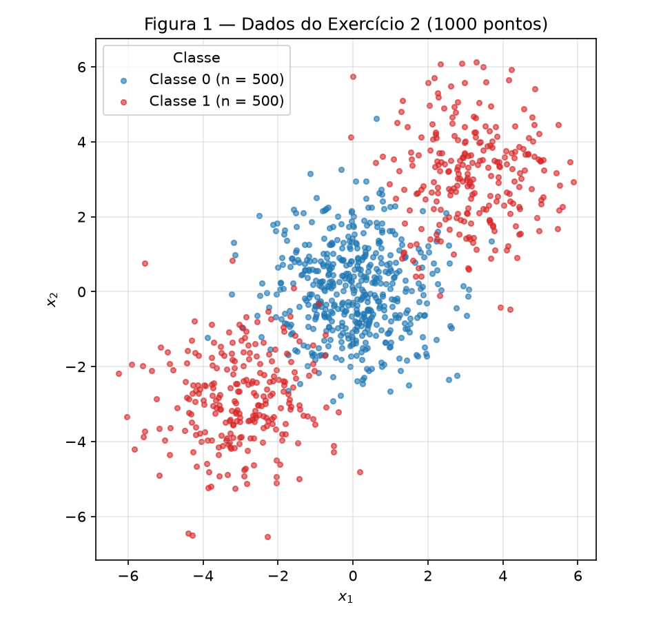
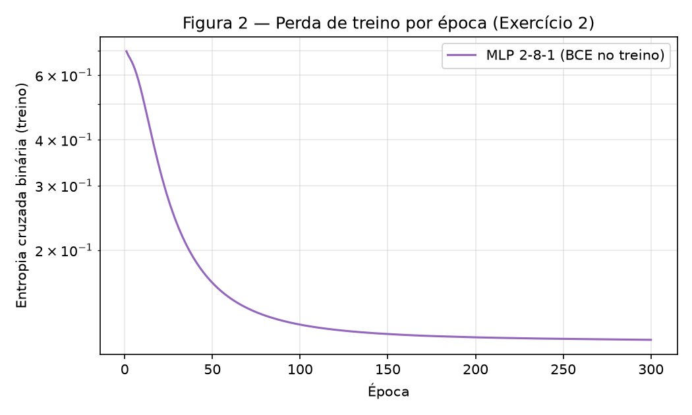
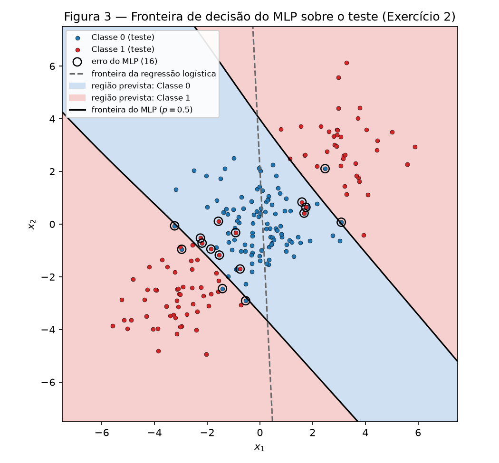
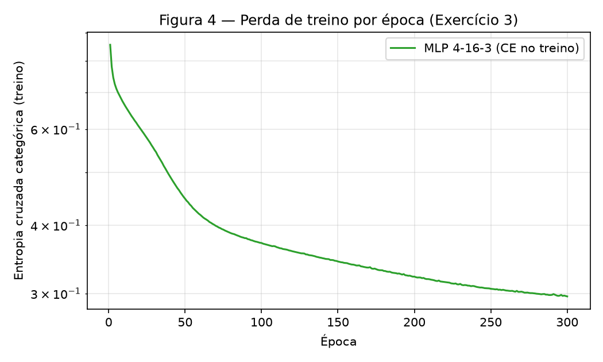
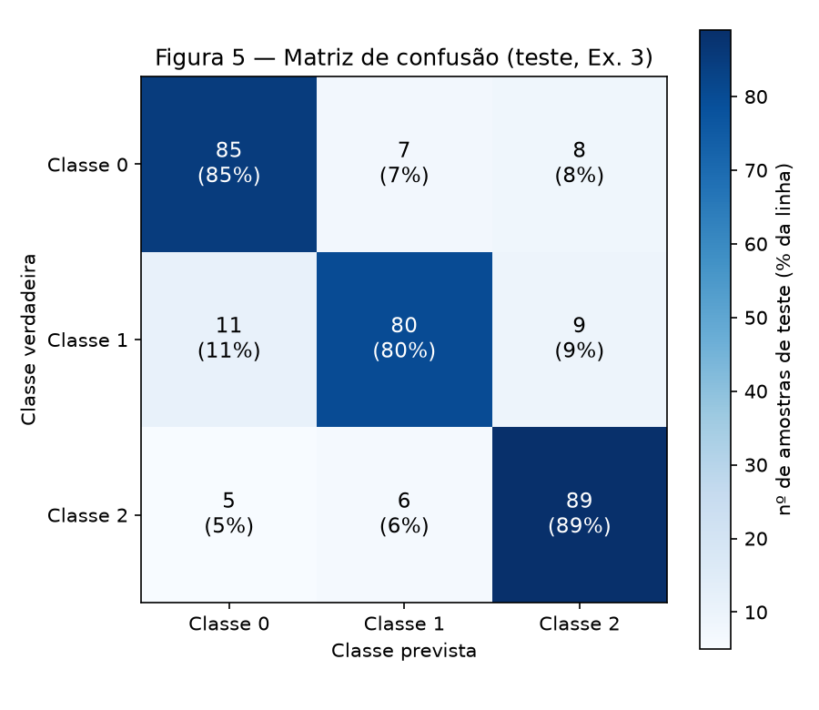
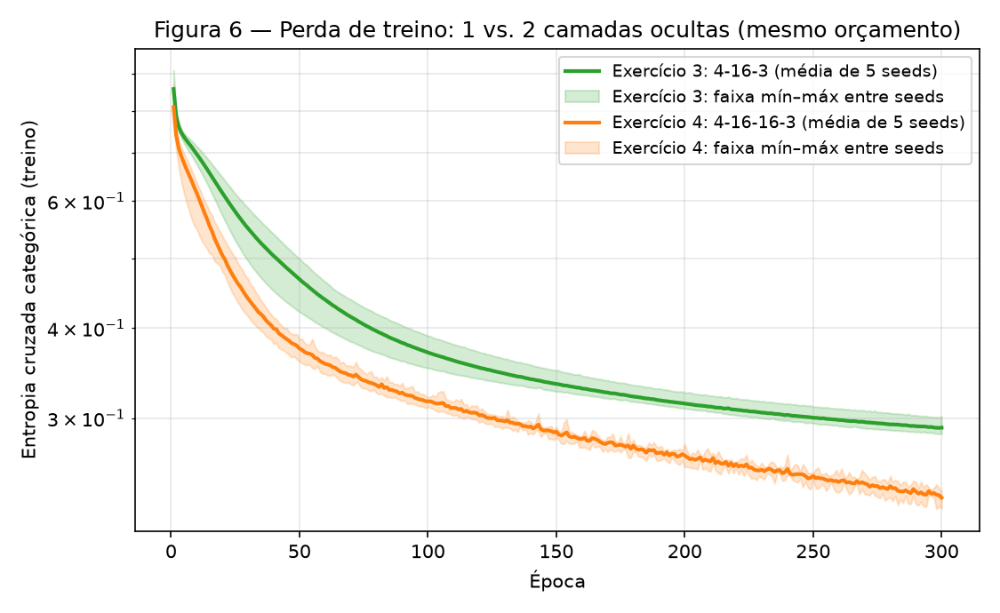
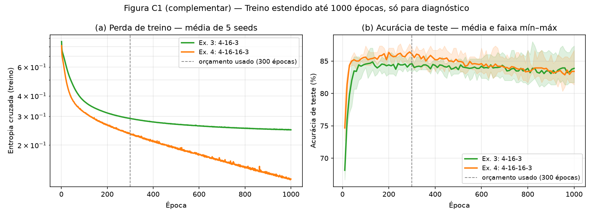

# 3. MLP — O que uma camada oculta compra

!!! info "Como reproduzir"

    ```bash
    python3 -m pip install -r requirements.txt
    python3 docs/exercises/mlp/code/main.py
    ```

    `main.py` cria **um único** gerador `rng = np.random.default_rng(42)` e o passa, nessa ordem,
    para os Exercícios 2, 3 e 4 (o Exercício 1 não sorteia nada). Esse `rng` faz a inicialização
    dos pesos e o embaralhamento dos mini-lotes. A única exceção é a exigida pelo próprio enunciado:
    a comparação do Exercício 4 em várias seeds cria um gerador por seed (42 a 46). O script
    regrava todas as figuras em `figures/` e todos os números em `code/results.json` (≈ 30 s).
    Todo número citado neste relatório vem desse arquivo.

    O MLP (ativações, perdas, forward, gradientes e atualização) está escrito à mão em NumPy em
    `code/mlp.py`. Do scikit-learn uso só `make_blobs`, `make_classification`, `train_test_split`,
    `confusion_matrix` e, apenas como baseline, `LogisticRegression`.

| Arquivo | Conteúdo |
|---------|----------|
| `code/mlp.py` | o MLP do zero: `MLP(layer_sizes, loss, rng)`, perdas BCE / CE / MSE, padronização |
| `code/main.py` | ponto de entrada: seed única, roda os 4 exercícios, grava `results.json` |
| `code/ex1_backprop_check.py` | Exercício 1: confere a conta à mão rodando a mesma rede em `mlp.py` |
| `code/ex2_binary.py` | Exercício 2: dados, baseline linear, MLP binário, Figuras 1–3 |
| `code/ex3_multiclass.py` | Exercício 3: dados, MLP de 3 classes, Figuras 4–5, estrutura dos clusters |
| `code/ex4_depth.py` | Exercício 4: 1 vs. 2 camadas ocultas em 5 seeds, Figura 6 e controles |

??? example "Código — `mlp.py` (a rede usada nos Exercícios 2, 3 e 4)"

    ``` python
    --8<-- "docs/exercises/mlp/code/mlp.py"
    ```

??? example "Código — `main.py`"

    ``` python
    --8<-- "docs/exercises/mlp/code/main.py"
    ```

---

## Exercício 1

**Um passo de backpropagation, à mão.**
Rede 2–2–1, $\tanh$ nas duas camadas, perda $L = (y - \hat y)^2$ com $N = 1$. A conta abaixo
foi feita à mão, com 6 casas decimais em cada valor intermediário (carregando a precisão
completa entre os passos). Uso a convenção do enunciado: a linha $i$ de $\mathbf{W}^{(1)}$ são os
pesos do neurônio oculto $i$, então $z^{(1)}_i = \sum_j W^{(1)}_{ij} x_j + b^{(1)}_i$.

Dados: $\mathbf{x} = [0.5,\ -0.2]$, $y = 1$,
$\mathbf{W}^{(1)} = \begin{bmatrix} 0.3 & -0.1 \\ 0.2 & 0.4 \end{bmatrix}$,
$\mathbf{b}^{(1)} = [0.1,\ -0.2]$, $\mathbf{W}^{(2)} = [0.5,\ -0.3]$, $b^{(2)} = 0.2$, $\eta = 0.3$.

### A — Forward pass

**1. Pré-ativações ocultas** $\mathbf{z}^{(1)} = \mathbf{W}^{(1)}\mathbf{x} + \mathbf{b}^{(1)}$:

$$
\begin{aligned}
z^{(1)}_1 &= 0.3(0.5) + (-0.1)(-0.2) + 0.1 = 0.15 + 0.02 + 0.1 = \mathbf{0.270000} \\
z^{(1)}_2 &= 0.2(0.5) + 0.4(-0.2) - 0.2 = 0.10 - 0.08 - 0.2 = \mathbf{-0.180000}
\end{aligned}
$$

**2. Ativações ocultas** $\mathbf{h}^{(1)} = \tanh(\mathbf{z}^{(1)})$:

$$
h^{(1)}_1 = \tanh(0.27) = \mathbf{0.263625}, \qquad
h^{(1)}_2 = \tanh(-0.18) = \mathbf{-0.178081}
$$

**3. Pré-ativação da saída** $u^{(2)} = \mathbf{W}^{(2)}\mathbf{h}^{(1)} + b^{(2)}$:

$$
u^{(2)} = 0.5(0.2636248) + (-0.3)(-0.1780809) + 0.2 = 0.1318124 + 0.0534243 + 0.2 = \mathbf{0.385237}
$$

**4. Saída e perda:**

$$
\hat y = \tanh(0.385237) = \mathbf{0.367247}, \qquad
L = (1 - 0.367247)^2 = 0.632753^2 = \mathbf{0.400377}
$$

### B — Backward pass

Uso $\frac{d}{du}\tanh(u) = 1 - \tanh^2(u)$, que se escreve com a própria saída: se $a = \tanh(u)$,
então $\frac{da}{du} = 1 - a^2$.

**1. Da perda até a pré-ativação da saída.** $\dfrac{\partial L}{\partial \hat y} = -2(y - \hat y)$
e $\dfrac{\partial \hat y}{\partial u^{(2)}} = 1 - \hat y^2$, então

$$
\begin{aligned}
\frac{\partial L}{\partial \hat y} &= -2(1 - 0.367247) = \mathbf{-1.265507} \\
1 - \hat y^2 &= 1 - 0.134870 = 0.865130 \\
\delta^{(2)} \equiv \frac{\partial L}{\partial u^{(2)}} &= \frac{\partial L}{\partial \hat y}\cdot\frac{\partial \hat y}{\partial u^{(2)}}
= (-1.265507)(0.865130) = \mathbf{-1.094828}
\end{aligned}
$$

**2. Camada de saída.** Como $u^{(2)} = \sum_j W^{(2)}_j h^{(1)}_j + b^{(2)}$, temos
$\partial u^{(2)}/\partial W^{(2)}_j = h^{(1)}_j$ e $\partial u^{(2)}/\partial b^{(2)} = 1$:

$$
\begin{aligned}
\frac{\partial L}{\partial \mathbf{W}^{(2)}} &= \delta^{(2)}\,\mathbf{h}^{(1)}
= [(-1.094828)(0.263625),\ (-1.094828)(-0.178081)] \\
&= \mathbf{[-0.288624,\ 0.194968]} \\
\frac{\partial L}{\partial b^{(2)}} &= \delta^{(2)} = \mathbf{-1.094828}
\end{aligned}
$$

**3. Propagando para trás.** $\partial u^{(2)}/\partial h^{(1)}_j = W^{(2)}_j$ e
$\partial h^{(1)}_j/\partial z^{(1)}_j = 1 - (h^{(1)}_j)^2$:

$$
\begin{aligned}
\frac{\partial L}{\partial \mathbf{h}^{(1)}} &= \delta^{(2)}\,\mathbf{W}^{(2)}
= [(-1.094828)(0.5),\ (-1.094828)(-0.3)] \\
&= \mathbf{[-0.547414,\ 0.328448]} \\
1 - (\mathbf{h}^{(1)})^2 &= [1 - 0.069498,\ 1 - 0.031713] = [0.930502,\ 0.968287] \\
\delta^{(1)} \equiv \frac{\partial L}{\partial \mathbf{z}^{(1)}} &= \frac{\partial L}{\partial \mathbf{h}^{(1)}} \odot \big(1 - (\mathbf{h}^{(1)})^2\big)
= [(-0.547414)(0.930502),\ (0.328448)(0.968287)] \\
&= \mathbf{[-0.509370,\ 0.318032]}
\end{aligned}
$$

**4. Camada oculta.** $\partial z^{(1)}_i/\partial W^{(1)}_{ij} = x_j$ e $\partial z^{(1)}_i/\partial b^{(1)}_i = 1$,
então $\partial L/\partial \mathbf{W}^{(1)} = \delta^{(1)}\mathbf{x}^\top$ (produto externo):

$$
\begin{aligned}
\frac{\partial L}{\partial \mathbf{W}^{(1)}} &=
\begin{bmatrix} (-0.509370)(0.5) & (-0.509370)(-0.2) \\ (0.318032)(0.5) & (0.318032)(-0.2) \end{bmatrix}
= \mathbf{\begin{bmatrix} -0.254685 & 0.101874 \\ 0.159016 & -0.063606 \end{bmatrix}} \\
\frac{\partial L}{\partial \mathbf{b}^{(1)}} &= \delta^{(1)} = \mathbf{[-0.509370,\ 0.318032]}
\end{aligned}
$$

### C — Atualização dos parâmetros

$\theta \leftarrow \theta - \eta\,\partial L/\partial\theta$ com $\eta = 0.3$. O enunciado fala em
"oito parâmetros"; contando escalar por escalar a rede tem **nove** (4 em $\mathbf{W}^{(1)}$, 2 em
$\mathbf{b}^{(1)}$, 2 em $\mathbf{W}^{(2)}$ e 1 em $b^{(2)}$). Atualizo todos:

| Parâmetro | Valor antigo | Gradiente | $-\eta \cdot$ gradiente | **Valor novo** |
|:--|--:|--:|--:|--:|
| $W^{(2)}_1$ | 0.500000 | −0.288624 | +0.086587 | **0.586587** |
| $W^{(2)}_2$ | −0.300000 | 0.194968 | −0.058490 | **−0.358490** |
| $b^{(2)}$ | 0.200000 | −1.094828 | +0.328448 | **0.528448** |
| $W^{(1)}_{11}$ | 0.300000 | −0.254685 | +0.076405 | **0.376405** |
| $W^{(1)}_{12}$ | −0.100000 | 0.101874 | −0.030562 | **−0.130562** |
| $W^{(1)}_{21}$ | 0.200000 | 0.159016 | −0.047705 | **0.152295** |
| $W^{(1)}_{22}$ | 0.400000 | −0.063606 | +0.019082 | **0.419082** |
| $b^{(1)}_1$ | 0.100000 | −0.509370 | +0.152811 | **0.252811** |
| $b^{(1)}_2$ | −0.200000 | 0.318032 | −0.095410 | **−0.295410** |

**A perda desce.** Um passo de descida do gradiente anda na direção $-\nabla L$, e pela
expansão de Taylor de primeira ordem
$\Delta L \approx \nabla L \cdot \Delta\theta = -\eta\,\lVert\nabla L\rVert^2 \le 0$. Aqui, somando
os quadrados dos nove gradientes ($\mathbf{W}^{(2)}$, $b^{(2)}$, $\mathbf{W}^{(1)}$, $\mathbf{b}^{(1)}$):

$$
\begin{aligned}
\lVert\nabla L\rVert^2 &= (0.083304 + 0.038012) + 1.198648 + (0.064864 + 0.010378 + 0.025286 + 0.004046) \\
&\quad + (0.259458 + 0.101145) = 1.785141,
\end{aligned}
$$

então a previsão linear é $\Delta L \approx -0.3 \times 1.785141 = -0.535542$. Esse valor é maior que a
própria perda (0.400377), ou seja, $\eta = 0.3$ é um passo grande e a aproximação linear exagera.
O sinal, porém, vale para todo passo pequeno o suficiente. Refazendo o forward com os parâmetros
novos, à mão:

$$
\begin{aligned}
z^{(1)}_1 &= 0.376405(0.5) + (-0.130562)(-0.2) + 0.252811 = 0.467126 \\
z^{(1)}_2 &= 0.152295(0.5) + 0.419082(-0.2) - 0.295410 = -0.303079 \\
\mathbf{h}^{(1)} &= [\tanh(0.467126),\ \tanh(-0.303079)] = [0.435874,\ -0.294127] \\
u^{(2)} &= 0.586587(0.435874) + (-0.358490)(-0.294127) + 0.528448 = 0.889568 \\
\hat y &= \tanh(0.889568) = 0.711181, \qquad L = (1 - 0.711181)^2 = \mathbf{0.083417}
\end{aligned}
$$

A perda cai de **0.400377 para 0.083417**. A intuição: como $\hat y = 0.367 < y = 1$, todo
parâmetro se moveu para aumentar $u^{(2)}$. O viés $b^{(2)}$ subiu 0.328; $W^{(2)}_1$ cresceu (porque
$h^{(1)}_1 > 0$) e $W^{(2)}_2$ ficou mais negativo (porque $h^{(1)}_2 < 0$); na camada oculta,
$h^{(1)}_1$ aumentou e $h^{(1)}_2$ diminuiu, que é o que os sinais de $\mathbf{W}^{(2)}$ pedem. No
total, $u^{(2)}$ foi de 0.385 para 0.890.

??? example "Conferência numérica — `ex1_backprop_check.py` (não substitui a conta acima)"

    O script roda a mesma rede na classe `MLP` de `mlp.py` (perda `MeanSquaredErrorTanh`) e compara
    com os valores escritos à mão: a maior diferença é **4.72 × 10⁻⁷** (só arredondamento da 6ª casa).
    Os gradientes do `backward` também batem com diferenças finitas centrais
    (erro máximo **8.3 × 10⁻¹¹**), o que valida o código usado nos Exercícios 2–4.

    ``` python
    --8<-- "docs/exercises/mlp/code/ex1_backprop_check.py"
    ```

---

## Exercício 2

**Classificação binária que uma reta não resolve.**

??? example "Código completo — `ex2_binary.py`"

    ``` python
    --8<-- "docs/exercises/mlp/code/ex2_binary.py"
    ```

### A — Gere os dados

`make_data()` usa exatamente os parâmetros do enunciado (`make_blobs` com centros
$(0,0)$, $(3,3)$, $(-3,-3)$, `cluster_std=1.2`, `random_state=42`; classe 1 = os dois clusters
externos). São 500 pontos por classe. A divisão é `train_test_split(..., test_size=0.2,
random_state=42, stratify=y)`: **800 de treino e 200 de teste**, 50% de cada classe nos dois.


/// caption
**Figura 1** — Os 1000 pontos, coloridos por classe. A classe 1 (vermelho) está dos dois lados da classe 0 (azul), ao longo da diagonal.
///

### B — Baseline linear

`LogisticRegression()` nos dados de treino crus: **acurácia de teste = 47.50%** (95 de 200), pior que
chutar. Os coeficientes aprendidos são quase nulos, $w = (0.0296,\ 0.0015)$ e $b = -0.0031$, e as
probabilidades previstas no teste ficam todas entre **0.457 e 0.544**. O item D explica por quê.

### C — Implemente o MLP

**Implementação (`mlp.py`).** A classe `MLP(layer_sizes, loss, rng)` recebe a lista de tamanhos das
camadas, então serve para qualquer profundidade. Camadas ocultas usam $\tanh$. A ativação de saída
vem junto com a perda, porque o gradiente na saída depende do par. Com um lote $X$ de $N$ amostras e
$L$ camadas:

* **forward:** $H^{(0)} = X$, $\;U^{(l)} = H^{(l-1)}\mathbf{W}^{(l)\top} + \mathbf{b}^{(l)}$,
  $\;H^{(l)} = \tanh(U^{(l)})$ para $l < L$, e $\hat Y = g(U^{(L)})$, com $g$ a ativação de saída;
* **perda (binária):** saída sigmoide $p = \sigma(u)$ e entropia cruzada binária
  $\mathcal{L} = -\frac{1}{N}\sum_n \big[y_n\log p_n + (1-y_n)\log(1-p_n)\big]$. Como
  $\frac{\partial \mathcal{L}}{\partial p} = \frac{1}{N}\frac{p-y}{p(1-p)}$ e $\sigma'(u) = p(1-p)$,
  o produto simplifica para $\frac{\partial \mathcal{L}}{\partial u} = \frac{p - y}{N}$;
* **backward:** $\Delta^{(L)} = \partial\mathcal{L}/\partial U^{(L)}$ (vem da perda) e, para cada camada de trás
  para frente, $\;\partial\mathcal{L}/\partial\mathbf{W}^{(l)} = \Delta^{(l)\top}H^{(l-1)}$,
  $\;\partial\mathcal{L}/\partial\mathbf{b}^{(l)} = \sum_n \Delta^{(l)}_n$ e
  $\;\Delta^{(l-1)} = \big(\Delta^{(l)}\mathbf{W}^{(l)}\big)\odot\big(1 - (H^{(l-1)})^2\big)$.
  São as mesmas regras do Exercício 1, em forma matricial;
* **atualização:** $\theta \leftarrow \theta - \eta\,\partial\mathcal{L}/\partial\theta$, em mini-lotes
  embaralhados a cada época.

Pesos iniciais Xavier/Glorot, $\mathcal{N}\big(0,\ 2/(n_\text{in}+n_\text{out})\big)$, e vieses zerados. As
entradas são padronizadas com média e desvio do **treino** (sem vazamento do teste).

**Treino e resultado.**

| Item | Valor |
|------|-------|
| Arquitetura | **2 – 8 – 1**: 8 neurônios ocultos $\tanh$, saída sigmoide (33 parâmetros) |
| Perda | entropia cruzada binária |
| Otimizador | SGD, mini-lotes de 32, taxa de aprendizado **$\eta = 0.05$** |
| Épocas | **300** |
| Perda de treino | 0.6972 (época 1) → **0.1139** (época 300) |
| Acurácia de treino | 96.50% |
| **Acurácia de teste** | **92.00%** (16 erros em 200) |

Os hiperparâmetros são valores usuais. As 300 épocas bastam porque a perda já estabiliza (Figura 2), e
os mesmos valores são reaproveitados nos Exercícios 3 e 4. Como referência, a regra de Bayes calculada
com os parâmetros verdadeiros das gaussianas acerta **93.00%** do mesmo teste. É o teto para esses
dados, e o MLP fica a 1 ponto dele.


/// caption
**Figura 2** — Perda de treino por época (escala log). Começa em 0.697 ≈ ln 2, a perda de quem responde 50% para tudo, cai rápido nas primeiras ~50 épocas e se estabiliza perto de 0.114.
///


/// caption
**Figura 3** — Regiões de decisão do MLP (sombreado) sobre os 200 pontos de teste. Os círculos são os 16 erros. A reta tracejada é a fronteira da regressão logística do item B.
///

### D — Análise

**A região que o MLP atribui à classe 1 (Figura 3) tem dois pedaços desconexos.** São os dois
semiplanos além de duas fronteiras quase paralelas, que cortam a diagonal $(t, t)$ em
$t = -1.62$ e $t = +1.71$. Entre elas fica uma faixa da classe 0 que corre ao longo da antidiagonal
$(t, -t)$ e não se fecha: ao longo dela a fronteira nunca é cruzada. Os erros (círculos) estão todos
perto das duas fronteiras, onde as gaussianas se sobrepõem.

**Nenhuma reta produz essa região.** Uma reta divide o plano em dois semiplanos, e semiplanos são
convexos: se o lado "classe 1" contém um ponto perto de $(3,3)$ e outro perto de $(-3,-3)$, ele contém
o segmento inteiro entre os dois, incluindo $(0,0)$, o centro da classe 0. O melhor que uma reta
consegue é isolar **um** dos clusters e sacrificar o outro. Varrendo 720 direções e todos os limiares no
treino, a melhor reta acerta **74.25%**. O MLP resolve o problema porque cada
neurônio oculto $\tanh$ é uma "reta suave". A camada de saída combina essas retas como um **OU**:
classe 1 se o ponto está além da fronteira de cima **ou** além da de baixo.

**Por que a regressão logística fica abaixo de 50%, e não nos 74% da melhor reta.** As duas classes
têm praticamente a mesma média. No treino, a classe 0 tem média $(0.02,\ 0.05)$ e a classe 1 tem
$(0.21,\ 0.20)$, porque seus dois clusters em $(3,3)$ e $(-3,-3)$ se cancelam. O logit da regressão
logística é linear em $x$, então ela só consegue explorar diferenças de média. Partindo de
$w = 0$, um passo de Newton dá $w \approx \Sigma^{-1}(\bar m_1 - \bar m_0) = (0.0296,\ 0.0015)$, que é
exatamente o que o `LogisticRegression` devolveu. A diferença entre as médias é pequena e aponta
para a diagonal. Ao longo da diagonal, porém, a variância é enorme (autovalores da covariância do treino: 10.93 na
direção da diagonal e 1.45 na da antidiagonal), porque é ali que estão os clusters em $\pm 3$. Por isso $\Sigma^{-1}$
encolhe essa componente e sobra um vetor minúsculo, quase horizontal e decidido pelo ruído. Sacrificar
um cluster inteiro, como faz a melhor reta, custaria uma log-loss enorme (pontos a ~4 unidades do lado
errado), e a log-loss prefere ficar "em cima do muro".

O resultado é a reta tracejada da Figura 3: quase vertical, passando pelo meio da classe 0. No teste,
ela põe 47 dos 100 pontos da classe 0 do lado "classe 1", acerta **todo** o cluster de cima (42
pontos) e erra **todo** o de baixo (58 pontos). Isso dá $(53 + 42)/200 = 47.5\%$. Ficou abaixo de 50%
por amostragem: no treino o cluster de cima tinha mais pontos (208 contra 192), o que inclinou $w$
levemente a favor dele, e no teste a proporção se inverteu (42 contra 58). Estruturalmente o
baseline é uma moeda; o lado em que ela cai é ruído.

---

## Exercício 3

**Multiclasse, mesma rede.**

??? example "Código completo — `ex3_multiclass.py`"

    ``` python
    --8<-- "docs/exercises/mlp/code/ex3_multiclass.py"
    ```

### A — Gere os dados

`make_data()` chama `make_classification` com exatamente os parâmetros do enunciado (1500 amostras,
4 features informativas, 3 classes, 2 clusters por classe, `class_sep=1.0`, `random_state=42`) e
divide 80/20 com `random_state=42` e `stratify=y`: **1200 de treino e 300 de teste**, 100 por classe
no teste. As features são padronizadas com média e desvio do treino.

### B — Adapte a rede

As mudanças ficam só na saída e na perda: **3 unidades de saída, softmax e entropia cruzada
categórica** (`CategoricalCrossEntropy(3)` em `mlp.py`).

**Derivação de $\partial L/\partial u$ para softmax + entropia cruzada.** Para uma amostra com rótulo
one-hot $\mathbf{y}$ ($\sum_k y_k = 1$) e pré-ativações de saída $\mathbf{u}$:

$$
p_k = \frac{e^{u_k}}{\sum_j e^{u_j}}, \qquad L = -\sum_k y_k \log p_k .
$$

*Jacobiano da softmax.* Pela regra do quociente, se $k = j$:
$\frac{\partial p_k}{\partial u_k} = \frac{e^{u_k}\sum_j e^{u_j} - e^{u_k}e^{u_k}}{(\sum_j e^{u_j})^2} = p_k(1 - p_k)$.
Se $k \ne j$: $\frac{\partial p_k}{\partial u_j} = \frac{-e^{u_k}e^{u_j}}{(\sum_i e^{u_i})^2} = -p_k p_j$.
Nos dois casos,

$$
\frac{\partial p_k}{\partial u_j} = p_k(\delta_{kj} - p_j).
$$

*Regra da cadeia.* $\frac{\partial L}{\partial p_k} = -\frac{y_k}{p_k}$, então

$$
\frac{\partial L}{\partial u_j} = \sum_k \frac{\partial L}{\partial p_k}\frac{\partial p_k}{\partial u_j}
= -\sum_k \frac{y_k}{p_k}\,p_k(\delta_{kj} - p_j)
= -\sum_k y_k\delta_{kj} + p_j\sum_k y_k
= -y_j + p_j \cdot 1
= \boxed{\,p_j - y_j\,}
$$

Para a média num lote de $N$ amostras, $\partial \mathcal{L}/\partial U = (P - Y)/N$.

**Por que fica tão simples.** O $1/p_k$ que vem da derivada do log cancela exatamente o fator $p_k$
do Jacobiano da softmax, e a restrição $\sum_k y_k = 1$ elimina o resto. É o mesmo cancelamento da
sigmoide com a BCE no Exercício 2, onde $\partial\mathcal{L}/\partial u = p - y$. Nos dois casos o
gradiente na saída é **o erro de previsão**: fica em $[-1, 1]$, é grande quando o modelo está
confiante e errado, e não some quando a saída satura, ao contrário do que aconteceria com MSE sobre a
softmax. A sigmoide + BCE é o caso $K = 2$ da softmax + CE.

**Reuso literal (ponto extra).** `forward`, `backward` e `step` da classe `MLP` são o mesmo código,
intocado, nos Exercícios 2, 3 e 4. O `backward` começa por `delta = self.loss.grad_u(...)` e não sabe
qual perda está usando. Tamanho das camadas, perda e hiperparâmetros são argumentos:

```python
# Exercício 2 (ex2_binary.py)
net = MLP([2, 8, 1], BinaryCrossEntropy(), rng)
# Exercício 3 (ex3_multiclass.py)
net = MLP([4, 16, 3], CategoricalCrossEntropy(3), rng)
# Exercício 4 (ex4_depth.py)
net = MLP([4, 16, 16, 3], CategoricalCrossEntropy(3), rng)
```

### C — Treine e avalie

| Item | Valor |
|------|-------|
| Arquitetura | **4 – 16 – 3**: 16 neurônios ocultos $\tanh$, saída softmax (131 parâmetros) |
| Perda | entropia cruzada categórica |
| Otimizador | SGD, mini-lotes de 32, **$\eta = 0.05$** (iguais ao Exercício 2) |
| Épocas | **300** |
| Perda de treino | 0.8562 (época 1) → **0.2963** (época 300) |
| Acurácia de treino | 89.42% |
| **Acurácia de teste** | **84.67%** (254 de 300) |


/// caption
**Figura 4** — Perda de treino por época (escala log). Cai rápido até ~50 épocas e depois desce devagar, sem estabilizar por completo em 300 épocas.
///


/// caption
**Figura 5** — Matriz de confusão no teste (contagens; entre parênteses, % da linha). Cada classe tem 100 amostras de teste.
///

### D — Análise

**Par mais confundido.** Somando os dois sentidos na Figura 5: **0–1 = 7 + 11 = 18 erros**,
1–2 = 9 + 6 = 15 e 0–2 = 8 + 5 = 13. O par mais confundido é **0 ↔ 1**, e a classe 1 é a mais
difícil (20 dos seus 100 pontos errados). A diferença para o par 1–2 é de só 3 pontos de teste, por
isso conferi nas 5 seeds do Exercício 4 (mesma arquitetura). As confusões 0–1 foram 19, 14, 19, 17 e 18,
e as 1–2 foram 16, 19, 15, 21 e 18. Os dois pares se alternam como "o mais confundido", enquanto 0–2
é sempre o menor (8 a 12). O resultado robusto é este: **a classe 1 é confundida com as duas
vizinhas**.

**Explicação pela estrutura dos dados.** O `make_classification` põe os centros dos 6 clusters
em vértices de um hipercubo em $\mathbb{R}^4$ com coordenadas $\pm$`class_sep` $= \pm 1$. Depois
deforma cada cluster com uma transformação linear aleatória, de modo que cada um vira um elipsoide
alongado. Vértices que diferem em uma só coordenada ficam a apenas $2 \times$ `class_sep` $= 2$ de
distância. Para medir isso recuperei a que cluster pertence cada amostra: o gerador sorteia tudo antes
de embaralhar, então `shuffle=False` devolve os mesmos pontos em ordem de cluster (função
`recover_clusters`, que confere o casamento linha a linha). O MLP não vê esse índice; só a análise usa.
Estimando no treino a média e a covariância de cada cluster:

| Cluster | Classe | Centro (≈ vértice) | Desvios nos eixos principais | Erros no teste |
|:--:|:--:|:--:|:--:|:--:|
| C0 | 0 | (−, −, −, −) | 0.47 · 0.68 · 1.47 · 1.83 | 8 / 51 (5 → classe 1) |
| **C1** | **1** | **(−, +, −, −)** | **0.67 · 1.06 · 1.67 · 1.82** | **15 / 49** (9 → classe 0, 6 → classe 2) |
| C2 | 2 | (−, +, −, +) | 0.32 · 0.77 · 1.31 · 1.95 | 9 / 46 (6 → classe 1) |
| C3 | 0 | (+, −, +, +) | 0.15 · 0.83 · 1.62 · 1.65 | 7 / 49 |
| C4 | 1 | (−, +, +, +) | 0.07 · 0.49 · 1.08 · 1.35 | 3 / 49 |
| C5 | 2 | (+, +, +, −) | 0.43 · 0.60 · 1.25 · 1.96 | 4 / 56 |

O cluster **C1 (classe 1) é vizinho de vértice tanto de C0 (classe 0), a uma distância de 2.10,
quanto de C2 (classe 2), a 2.03**, e é o mais espalhado dos seis. Medindo a sobreposição de cada par
de clusters de classes diferentes (a fração dos pontos que a gaussiana do outro cluster explica
melhor), **C0–C1 se sobrepõem em 8.6% e C1–C2 em 8.2%**. Todos os outros pares ficam em 3.8% ou
menos. Daí vêm os erros: C1 sozinho responde por 15 dos 46 erros do teste, e **14 das 18 confusões
0–1 acontecem entre C0 e C1** (9 + 5). A distância sozinha não basta para explicar: C2 e C4 têm os
centros mais próximos de todos (1.98, também vizinhos de vértice), mas se sobrepõem só 1.0%, porque C4
é muito achatado (desvios de 0.07 e 0.49 em dois eixos). O que decide é a forma que a transformação
aleatória deu a cada cluster.

Essa confusão está nos dados, não na rede. Um classificador **ideal**, que conhece as 6 gaussianas
(Bayes plug-in: prevê o cluster mais verossímil e devolve sua classe), acerta 89.33% do teste e erra
justamente os mesmos pares: 12 confusões 0–1, 13 confusões 1–2 e 7 confusões 0–2.

**Baseline e o que a camada oculta acrescentou.** A regressão logística multinomial acerta
**66.33%**; o MLP, **84.67%** (**+18.3 pontos**, de um teto de ~89%). Um classificador linear com
softmax dá a cada classe uma região **convexa** (onde $u_k \ge u_j$ para todo $j$, uma interseção de
semiespaços). Aqui cada classe é a união de dois clusters em vértices separados do hipercubo, com
clusters de outras classes entre eles. Por exemplo, os clusters da classe 1, C1 $(-,+,-,-)$ e
C4 $(-,+,+,+)$, têm C2 $(-,+,-,+)$ adjacente aos dois: o ponto médio entre C1 e C4 fica tão perto de
C2 quanto do próprio C1. É a mesma geometria do Exercício 2, agora em 4D. A camada oculta permite
regiões não convexas e desconexas, um pedaço por cluster. Os ~5 pontos que faltam até o teto vêm da
dificuldade de aprender fronteiras curvas entre elipsoides sobrepostos com 1200 exemplos.

---

## Exercício 4

**Uma segunda camada oculta ajuda?**

??? example "Código completo — `ex4_depth.py`"

    ``` python
    --8<-- "docs/exercises/mlp/code/ex4_depth.py"
    ```

### A — Treine a rede mais profunda

A única mudança é a profundidade. Mantive a largura do Exercício 3 e acrescentei uma camada oculta
igual. Dados, divisão, padronização, inicialização (Xavier), perda, $\eta = 0.05$, lotes de 32 e
**300 épocas** são os mesmos do Exercício 3.

| Item | Valor |
|------|-------|
| Arquitetura | **4 – 16 – 16 – 3**: duas camadas ocultas $\tanh$ de 16, saída softmax (403 parâmetros) |
| Perda de treino final | 0.2211 |
| Acurácia de treino | 92.42% |
| **Acurácia de teste** | **86.00%** (execução principal, `rng` compartilhado do relatório) |

### B — Compare

Cada seed $s \in \{42, 43, 44, 45, 46\}$ cria `np.random.default_rng(s)`, usado na inicialização e no
embaralhamento, e treina **as duas** redes com essa seed. Assim cada par compartilha a mesma seed e
só a profundidade muda. Médias (± desvio-padrão entre as 5 seeds), medidas na época 300:

| | Camadas ocultas | Parâmetros | Perda de treino final | Acurácia de teste |
|:--|:--:|:--:|:--:|:--:|
| Exercício 3 (4–16–3) | 1 | 131 | 0.2912 ± 0.0060 | **84.60% ± 0.77** |
| Exercício 4 (4–16–16–3) | 2 | 403 | 0.2327 ± 0.0043 | **86.07% ± 0.93** |

??? info "Por seed"

    | Seed | Ex. 3: acurácia | Ex. 4: acurácia | Diferença (Ex. 4 − Ex. 3) | Ex. 3: perda | Ex. 4: perda |
    |:--:|:--:|:--:|:--:|:--:|:--:|
    | 42 | 85.67% | 87.00% | +1.33 | 0.2928 | 0.2328 |
    | 43 | 85.00% | 84.33% | −0.67 | 0.2898 | 0.2347 |
    | 44 | 84.67% | 86.33% | +1.67 | 0.3018 | 0.2378 |
    | 45 | 83.33% | 86.67% | +3.33 | 0.2855 | 0.2248 |
    | 46 | 84.33% | 86.00% | +1.67 | 0.2859 | 0.2337 |
    | **média** | **84.60%** | **86.07%** | **+1.47** (desvio 1.43) | 0.2912 | 0.2327 |

    A seed 42 deste estudo não reproduz os 84.67% do Exercício 3: lá o `rng` compartilhado já tinha sido
    usado pelo Exercício 2, então a inicialização é outra.


/// caption
**Figura 6** — Perda de treino das duas redes nos mesmos eixos (média de 5 seeds; faixa = mínimo–máximo entre seeds; escala log). A rede de 2 camadas desce mais rápido e termina mais baixo.
///

**O que medi: neste orçamento, a rede mais funda ficou um pouco à frente**, com +1.47 pontos em
média, à frente em 4 das 5 seeds. O enunciado antecipa o contrário, mas o que se pede é reportar o que
se mede. Para separar "profundidade" de outras coisas, rodei dois controles com as mesmas 5 seeds e o
mesmo orçamento:

**Controle 1: mesmo número de parâmetros.** A rede de 2 camadas tem 3× mais parâmetros (403 contra
131). Comparando redes rasas e fundas de mesmo tamanho:

| Tamanho | 1 camada oculta | 2 camadas ocultas | Diferença |
|:--|:--:|:--:|:--:|
| ~135 parâmetros | 4–16–3 (131): 84.60% ± 0.77 | 4–8–8–3 (139): 84.20% ± 1.09 | **−0.40** |
| ~395 parâmetros | 4–48–3 (387): 85.67% ± 0.37 | 4–16–16–3 (403): 86.07% ± 0.93 | **+0.40** |

Com o número de parâmetros igualado, a profundidade não faz diferença: ±0.4 ponto, menos que o
desvio entre seeds. Quase todo o ganho do Exercício 4 vem de **capacidade**, e uma rede rasa e larga
(4–48–3) recupera 1.07 dos 1.47 pontos.

**Controle 2: treino mais longo** (Figura C1, só diagnóstico; o orçamento de 300 épocas foi fixado no
Exercício 3 e não foi escolhido por esta curva).

| Época | 50 | 100 | 200 | **300** | 500 | 1000 |
|:--|:--:|:--:|:--:|:--:|:--:|:--:|
| Teste — 1 camada | 83.47% | 84.53% | 84.40% | **84.60%** | 83.67% | 83.87% |
| Teste — 2 camadas | 85.20% | 85.60% | 86.33% | **86.07%** | 84.93% | 83.40% |
| Perda de treino — 1 camada | 0.468 | 0.370 | 0.314 | **0.291** | 0.268 | 0.248 |
| Perda de treino — 2 camadas | 0.375 | 0.317 | 0.266 | **0.233** | 0.191 | 0.124 |


/// caption
**Figura C1 (complementar)** — Mesmas 5 seeds treinadas até 1000 épocas: (a) perda de treino; (b) acurácia de teste medida a cada 10 épocas. A linha tracejada marca o orçamento usado (300 épocas).
///

### C — Análise

**A perda de treino e a acurácia de teste contam histórias diferentes.** Pela perda de treino
(Figura 6), a rede funda é muito melhor: 20% menor em 300 épocas (0.233 contra 0.291) e metade em 1000
épocas (0.124 contra 0.248). A acurácia de teste mal acompanha: +1.5 ponto em 300 épocas, e em 1000
épocas a rede funda já está **abaixo** da rasa (83.40% contra 83.87%) enquanto continua baixando a
perda de treino. A distância entre treino e teste cresce (acurácia de treino 89.50% → 91.27%; diferença
treino–teste de 4.90 para 5.20 pontos). Essa queda extra da perda de treino é a rede memorizando os
pontos da região de sobreposição. Eles são irredutíveis: até o classificador ideal do Exercício 3 erra
10.7% do teste.

**O tamanho do ganho também pede cautela.** 1.47 ponto são ~4 dos 300 pontos de teste, e o erro-padrão
binomial de **uma** acurácia nesse teste é $\sqrt{p(1-p)/300} \approx$ **2.08 pontos**. As seeds
controlam a variância da inicialização, mas não a do próprio conjunto de teste.

**O que a segunda camada acrescenta, em termos de representação, e o que custa.** Os dados são 6
nuvens gaussianas em vértices de um hipercubo 4D. Separar nuvens assim pede poucas fronteiras
aproximadamente planas, uma ou duas por par de clusters vizinhos, e uma camada oculta com 16 unidades
$\tanh$ já tem mais "retas suaves" do que o problema pede. O teorema de aproximação universal garante
que uma camada basta em princípio, e aqui ela basta na prática. O que limita a acurácia é a
sobreposição entre C1 e seus vizinhos (teto de ~89%), não a expressividade da rede. Uma segunda camada
compõe funções das features da primeira ("regiões feitas de regiões") e pode representar certas
funções com exponencialmente menos unidades. Esses dados, porém, não têm estrutura hierárquica para
ser composta. Quanto ao custo de otimização, ele não apareceu aqui: com só duas camadas $\tanh$,
inicialização Xavier e SGD em mini-lotes, os gradientes não somem, e a rede funda até converge mais
rápido por época (Figura 6). O custo apareceu como **variância**: mais parâmetros (403 para 1200
exemplos), mais sobreajuste quando o treino continua, e desvio entre seeds maior (0.93 contra 0.77
ponto em 300 épocas).

**Que dados fariam a profundidade valer a pena.** Dados com estrutura **composicional**, em que a
fronteira é feita de pedaços que se repetem ou se aninham. O exemplo formal é a função "serra" obtida
compondo $k$ vezes uma função tenda: ela tem $2^k$ dentes e sai de uma rede com $O(k)$ camadas estreitas,
mas uma rede rasa precisa de largura exponencial em $k$ para aproximá-la (Telgarsky, 2016). Na prática:
espirais entrelaçadas com muitas voltas, tabuleiros de xadrez com muitas casas e, sobretudo, imagens, som
e texto, em que bordas formam texturas, texturas formam partes e partes formam objetos. Também ajudaria ter muito mais
exemplos por parâmetro, para que a capacidade extra fosse usada para modelar a fronteira e não o ruído.
Com 6 nuvens gaussianas em 4D e 1200 pontos, a resposta honesta é que **a profundidade em si não
ajudou**: o ganho medido some quando se iguala o número de parâmetros e se inverte quando se treina
por mais tempo.

---

## Referências

* Enunciado: [3. MLP — ANN & DL 2026.2](https://insper.github.io/ann-dl/2026.2/exercises/mlp/){:target="_blank"}.
* X. Glorot, Y. Bengio. *Understanding the difficulty of training deep feedforward neural networks*. AISTATS, 2010 (inicialização Xavier).
* I. Guyon. *Design of experiments for the NIPS 2003 variable selection benchmark*, 2003 (algoritmo por trás de `make_classification`: clusters nos vértices de um hipercubo).
* G. Cybenko. *Approximation by superpositions of a sigmoidal function*. Mathematics of Control, Signals and Systems, 1989.
* M. Telgarsky. *Benefits of depth in neural networks*. COLT, 2016.

## Resumo dos resultados

| # | Item | Valor |
|:-:|------|-------|
| 1 | Ex. 1 — $\mathbf{z}^{(1)}$ e $\mathbf{h}^{(1)}$ | $\mathbf{z}^{(1)} = [0.270000,\ -0.180000]$; $\mathbf{h}^{(1)} = [0.263625,\ -0.178081]$ |
| 2 | Ex. 1 — $u^{(2)}$, $\hat y$ e $L$ | $u^{(2)} = 0.385237$; $\hat y = 0.367247$; $L = 0.400377$ |
| 3 | Ex. 1 — os parâmetros atualizados | $\mathbf{W}^{(1)} = \begin{bmatrix} 0.376405 & -0.130562 \\ 0.152295 & 0.419082 \end{bmatrix}$; $\mathbf{b}^{(1)} = [0.252811,\ -0.295410]$; $\mathbf{W}^{(2)} = [0.586587,\ -0.358490]$; $b^{(2)} = 0.528448$ (a perda cai para 0.083417) |
| 4 | Ex. 2 — acurácia de teste do baseline linear | **47.50%** |
| 5 | Ex. 2 — arquitetura e acurácia de teste | **2–8–1** ($\tanh$ / sigmoide, BCE, 33 parâmetros; $\eta = 0.05$, lotes de 32, 300 épocas): **92.00%** |
| 6 | Ex. 3 — arquitetura e acurácia de teste | **4–16–3** ($\tanh$ / softmax, CE, 131 parâmetros; mesmos hiperparâmetros): **84.67%** (baseline linear 66.33%) |
| 7 | Ex. 3 — par de classes mais confundido | **0 ↔ 1** (18 erros: 7 + 11); 1 ↔ 2 logo atrás (15) e se alterna com 0 ↔ 1 entre seeds |
| 8 | Ex. 4 — arquitetura e acurácia de teste | **4–16–16–3** (403 parâmetros; mesmo orçamento): **86.00%** (média de 5 seeds: 86.07%) |
| 9 | Ex. 4 — diferença de acurácia contra o Ex. 3 (média em ≥ 3 seeds) | **+1.47 ponto** (86.07% − 84.60%, 5 seeds; desvio 1.43). Com o número de parâmetros igualado: −0.40 / +0.40 |
