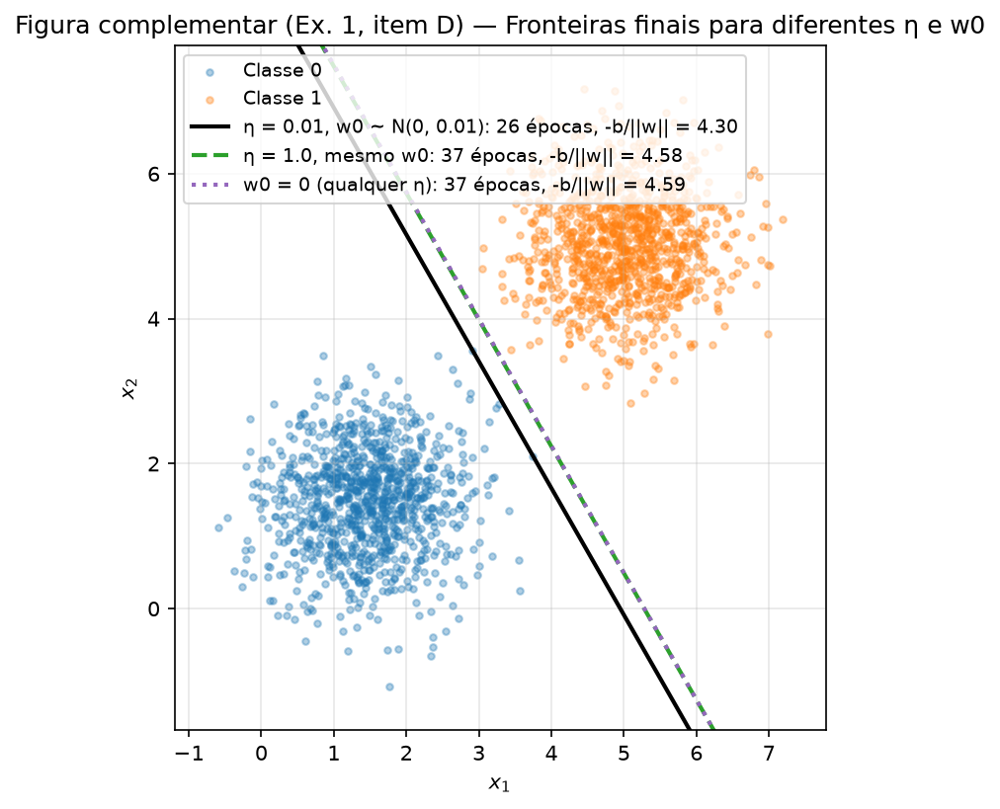
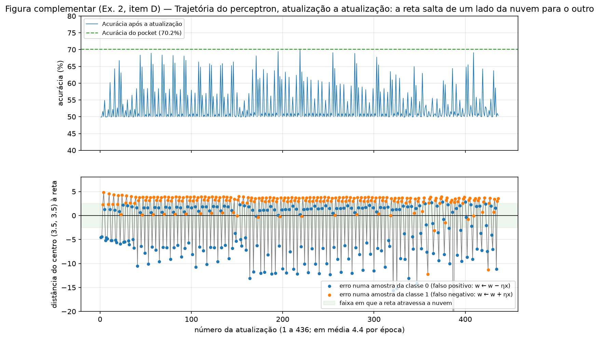

# 2. Perceptron — Entendendo o perceptron e suas limitações

!!! info "Como reproduzir"

    ```bash
    python3 -m pip install -r requirements.txt
    python3 docs/exercises/perceptron/code/main.py
    ```

    `main.py` cria **um único** gerador `rng = np.random.default_rng(42)` e o passa, nessa ordem,
    para os Exercícios 1 e 2. O script regrava todas as figuras em `figures/` e todos os números
    em `code/results.json` (leva cerca de 10 s). Todo número citado neste relatório vem desse
    arquivo. Só NumPy e Matplotlib são usados: o perceptron inteiro (ativação, previsão, regra de
    atualização e laço de treino) está em `code/perceptron.py`, escrito do zero. Nenhum modelo de
    biblioteca é usado, nem para referência.

!!! note "Uso de IA"

    Feito com auxílio de IA.

| Arquivo | Conteúdo |
|---------|----------|
| `code/main.py` | ponto de entrada: seed única, roda os 2 exercícios, grava `results.json` |
| `code/perceptron.py` | a classe `Perceptron`: `step`, `predict`, `accuracy`, `fit` (com a opção `pocket`) |
| `code/data.py` | geração das nuvens gaussianas dos itens A |
| `code/plots.py` | funções de desenho compartilhadas (nuvem, reta, pontos errados) |
| `code/ex1_separable.py` | Exercício 1: treino com $\eta = 0.01$ e $1.0$, início em zero, Figuras 1 a 3 |
| `code/ex2_overlapping.py` | Exercício 2: treino com pocket, referências, trajetória, Figuras 4 a 6 |

## Abordagem e desafios

**Abordagem.** Escrevi o perceptron como uma classe com quatro métodos curtos: `step` (degrau),
`predict` ($\hat y = \mathrm{step}(\mathbf w \cdot \mathbf x + b)$), `accuracy` e `fit`, que
contém o laço de treino do item B. O laço visita as 2000 amostras **na ordem em que foram
geradas** (as 1000 da classe 0 e depois as 1000 da classe 1), sem embaralhar, porque o enunciado
não pede embaralhamento e assim o `rng` só é usado para gerar dados e sortear $\mathbf w_0$. O
Exercício 2 reutiliza a mesma classe com `pocket=True`, que acrescenta ao laço exatamente uma
coisa: depois de cada atualização, medir a acurácia no dataset inteiro e copiar $(\mathbf w, b)$
se ela for a maior já vista. A cópia não altera a trajetória de $\mathbf w$ e $b$, então o
treino do Exercício 2 é, passo a passo, o mesmo do Exercício 1. Os números de apoio da análise
(margem máxima, melhor reta possível, regra de Bayes) são calculados só com NumPy, por
varredura de direções, sem treinar nada.

**Desafios.**

* *Repetir o treino "mudando só $\eta$".* Se `fit` sorteasse $\mathbf w_0$ toda vez, a segunda
  chamada do `rng` daria outro $\mathbf w_0$. Por isso `fit` aceita `w0` explícito: o run com
  $\eta = 1.0$ e o teste do início em zero recebem exatamente o mesmo vetor inicial.
* *Ordem de apresentação.* Como as classes vêm em blocos, um único erro no início de um bloco
  costuma virar a previsão do bloco inteiro (os pesos são pequenos, da ordem de uma
  atualização). Isso deixa a curva de acurácia do Exercício 1 em zigue-zague e explica por que
  o iterado final do Exercício 2 fica em 50%. Para não confundir causa com artefato, refiz os
  dois treinos com a ordem embaralhada e reporto os dois casos.
* *Definir "onde a reta está".* Para discutir a posição da fronteira usei duas medidas
  geométricas: o deslocamento $-b/\lVert \mathbf w \rVert$ (distância da origem à reta) e a
  distância com sinal do centro da nuvem à reta, $(\mathbf w \cdot \mathbf c + b)/\lVert \mathbf w \rVert$.
* *A referência de 73%.* Sem scikit-learn, a melhor reta possível na amostra foi encontrada por
  busca exaustiva (1800 direções, todos os limiares), o que dá o teto contra o qual comparar o
  pocket.

???+ example "Código — `perceptron.py` (a implementação, comentada)"

    ``` python
    --8<-- "docs/exercises/perceptron/code/perceptron.py"
    ```

??? example "Código — `data.py` (geração dos dados)"

    ``` python
    --8<-- "docs/exercises/perceptron/code/data.py"
    ```

??? example "Código — `main.py`"

    ``` python
    --8<-- "docs/exercises/perceptron/code/main.py"
    ```

---

## Exercício 1

**Dados separáveis: o caso para o qual o perceptron foi projetado.**

??? example "Código completo — `ex1_separable.py`"

    ``` python
    --8<-- "docs/exercises/perceptron/code/ex1_separable.py"
    ```

### A — Gere os dados

`generate_data(rng, EX1_MEANS, EX1_COV)` chama `rng.multivariate_normal` com 1000 amostras
por classe, $\boldsymbol\mu_0 = (1.5, 1.5)$, $\boldsymbol\mu_1 = (5, 5)$ e
$\Sigma = \mathrm{diag}(0.5, 0.5)$ para as duas. São 2000 pontos. Conferência com os valores
amostrais:

| Classe | Média especificada | Média amostral | Covariância especificada | Covariância amostral |
|:------:|:------------------:|:--------------:|:------------------------:|:--------------------:|
| 0 | (1.5, 1.5) | (1.450, 1.473) | diag(0.5, 0.5) | [[0.491, 0.029], [0.029, 0.513]] |
| 1 | (5, 5) | (5.010, 5.013) | diag(0.5, 0.5) | [[0.495, 0.010], [0.010, 0.499]] |


/// caption
**Figura 1** — Os 2000 pontos do Exercício 1, uma cor por classe. A distância entre os centros
($\sqrt{2}\cdot 3.5 = 4.95$) é sete vezes o desvio padrão ($\sqrt{0.5} = 0.71$): há um vão
vazio entre as nuvens.
///

### B — Implemente o perceptron

A classe `Perceptron` (código acima) segue o item B à letra:

* **Previsão:** $\hat y = \mathrm{step}(\mathbf w \cdot \mathbf x + b)$, com
  $\mathrm{step}(z) = 1$ se $z \ge 0$ e $0$ caso contrário (`step`, `predict`).
* **Regra de atualização:** para cada amostra, na ordem do dataset,
  $\mathbf w \leftarrow \mathbf w + \eta\,(y - \hat y)\,\mathbf x$ e
  $b \leftarrow b + \eta\,(y - \hat y)$, com $y, \hat y \in \{0, 1\}$. O erro $(y - \hat y)$ é
  $0$ num acerto (nada muda), $+1$ num falso negativo e $-1$ num falso positivo.
* **Inicialização:** $\mathbf w_0 \sim$ `rng.normal(0, 0.01, size=2)` e $b_0 = 0$. Neste
  relatório saiu $\mathbf w_0 = (0.00253, 0.00895)$, com $\lVert \mathbf w_0 \rVert = 0.0093$.
* **Taxa de aprendizado:** $\eta = 0.01$.
* **Parada:** até uma passada completa sem nenhuma atualização, ou 100 épocas. A acurácia no
  dataset inteiro é registrada ao fim de cada época (`epoch_accuracy`), junto com o número de
  atualizações da época (`epoch_updates`).

### C — Treine e meça

**1. Resultado do treino** ($\eta = 0.01$):

| Quantidade | Valor |
|------------|-------|
| $\mathbf w$ final | **(0.0505, 0.0289)** |
| $b$ final | **$-0.25$** |
| Épocas | **26** (a 26ª passada não fez nenhuma atualização; a última atualização foi na 25ª) |
| Acurácia final | **100%** (2000/2000; 0 pontos mal classificados) |
| Atualizações no total | 73 (49 falsos positivos e 24 falsos negativos), em 52 000 visitas a amostras |
| Reta | $0.0505\,x_1 + 0.0289\,x_2 - 0.25 = 0$, ou seja, $x_2 = -1.749\,x_1 + 8.659$ |
| Direção $\mathbf w/\lVert \mathbf w \rVert$ | (0.868, 0.496), ângulo de 29.8° com o eixo $x_1$ |
| Distância da reta ao ponto mais próximo | 0.0010 (um ponto da classe 1 quase encostado na reta) |

O viés confere com a contagem de erros: $b = b_0 + \eta\,(n_{FN} - n_{FP}) = 0.01\,(24 - 49) = -0.25$.

**2. Figura 2**, a fronteira $\mathbf w \cdot \mathbf x + b = 0$ sobre os dados. Nenhum ponto fica
do lado errado, então não há nenhum círculo de "ponto mal classificado" (a legenda registra o
zero). A reta passa pelo vão, mas encostada na classe 1: a distância ao ponto mais próximo é
0.001, porque o perceptron para na **primeira** reta que separa tudo, não na melhor.


/// caption
**Figura 2** — Fronteira de decisão do perceptron ($\eta = 0.01$) sobre os dados do Exercício 1.
Os semiplanos estão pintados com a cor da classe prevista. Pontos mal classificados seriam
marcados com um círculo preto; não há nenhum.
///

**3. Figura 3**, acurácia por época, com o número de atualizações de cada época nas barras.


/// caption
**Figura 3** — Acurácia no dataset inteiro ao fim de cada época (linha) e atualizações feitas
em cada época (barras). A partir da época 8 a curva sobe em zigue-zague até 100% na época 25;
a época 26 é a passada limpa que encerra o treino.
///

A curva não é monotônica: 50.3%, 50.5%, 51.5%, 53.7%, 52.9%, 58.5%, 57.8%, 85.5%, 60.1%,
86.0%, 65.2%, 94.3%, 67.0%, 70.6%, 81.7%, 93.0%, 74.1%, 84.7%, 94.5%, 77.1%, 86.6%, 95.2%,
83.7%, 92.5%, 100%, 100%. O motivo é a ordem em blocos. Enquanto $\lVert \mathbf w \rVert$ é da
ordem de uma única atualização ($\eta \lVert \mathbf x \rVert \approx 0.02$ na classe 0 e
$0.07$ na classe 1, contra $\lVert \mathbf w_0 \rVert = 0.009$), um erro no início do bloco da
classe 0 vira a previsão do bloco inteiro para 0, e um erro no início do bloco da classe 1 vira
tudo para 1. Cada época faz só 2 a 4 atualizações, mas cada uma joga a reta longe, e a
acurácia registrada ao fim da época depende de onde a reta caiu depois do último erro do bloco
da classe 1. À medida que $\mathbf w$ e $b$ acumulam ($\lVert \mathbf w \rVert$ vai de 0.009 a
0.058 e $b$ de 0 a $-0.25$), o salto relativo de cada atualização diminui e a reta passa a
cair cada vez mais perto do vão, até uma passada sem erro.

### D — Análise

**1. Por que dados separáveis convergem rápido.** A regra só age em erros:
$\Delta \mathbf w = \eta\,(y - \hat y)\,\mathbf x$ é zero nos acertos. Cada falso negativo soma
$\eta\,\mathbf x$ com $\mathbf x$ perto de $(5, 5)$ e cada falso positivo subtrai
$\eta\,\mathbf x$ com $\mathbf x$ perto de $(1.5, 1.5)$; nos dois casos o produto
$\mathbf w \cdot (\boldsymbol\mu_1 - \boldsymbol\mu_0)$ cresce, ou seja, **todo erro empurra
$\mathbf w$ na direção que separa as nuvens**, e $b$ acumula o deslocamento na mesma direção.
Como existe uma reta que separa as duas classes, esse processo termina: o teorema de
convergência do perceptron (Novikoff, 1962) garante, para dados separáveis com margem
$\gamma > 0$ e $\lVert (\mathbf x, 1) \rVert \le R$, no máximo $(R/\gamma)^2$ atualizações, em
qualquer ordem de apresentação. Nesta amostra a maior margem possível, achada por varredura de
3600 direções (`max_margin`), é $\gamma = 0.235$ na direção de 29.85°, e $R = 9.17$, o que dá
a cota $(9.17/0.235)^2 \approx 1527$; o perceptron precisou de **73**. Curiosamente, a direção
final (29.76°) é praticamente a da reta de margem máxima (29.85°), embora o deslocamento não
seja o do meio do vão.

Como o total de atualizações é finito, **o número de atualizações por época tem de cair a
zero**, e é isso que encerra o treino: na Figura 3 ele vai de 3–4 nas primeiras épocas para 2–3,
depois 1 na época 25 e 0 na época 26. A quantidade por época é pequena desde o início por causa
da ordem em blocos (um erro corrige o bloco inteiro). Com a ordem embaralhada (uma permutação
com o mesmo `rng`, mesmo $\mathbf w_0$), a queda é a do livro-texto: **20 atualizações na
época 1 e 0 na época 2**, acurácia 100% já ao fim da época 1, reta com direção de 63.2° e
distância mínima 0.105. Em qualquer ordem, o treino para porque os erros, que são o único
combustível da regra, acabam.

**2. Repetição com $\eta = 1.0$**, mudando só a taxa: mesmo $\mathbf w_0$, mesmo $b_0 = 0$,
mesmos dados, mesma ordem.

| | $\eta = 0.01$ | $\eta = 1.0$ |
|---|:---:|:---:|
| Épocas | **26** | **37** |
| Acurácia final | **100%** | **100%** |
| Atualizações (FP + FN) | 73 (49 + 24) | 101 (66 + 35) |
| $\mathbf w$ final | (0.0505, 0.0289) | (5.871, 3.359) |
| $b$ final | $-0.25$ | $-31$ |
| $\lVert \mathbf w \rVert$ | 0.058 | 6.76 |
| **Direção $\mathbf w/\lVert \mathbf w \rVert$** | **(0.868, 0.496)**, 29.76° | **(0.868, 0.497)**, 29.78° |
| Reta | $x_2 = -1.749\,x_1 + 8.659$ | $x_2 = -1.748\,x_1 + 9.228$ |
| Deslocamento $-b/\lVert \mathbf w \rVert$ | 4.30 | 4.58 |
| Distância ao ponto mais próximo | 0.001 | 0.182 |
| $\lVert \mathbf w_0 \rVert / \lVert \mathbf w \rVert$ | 16.0% | 0.14% |

Os dois runs chegam a 100%, por **retas diferentes**: a de $\eta = 1.0$ fica 0.28 mais longe da
origem (4.58 contra 4.30), com folga de 0.18 até o ponto mais próximo em vez de 0.001, e levou
37 épocas em vez de 26. As direções, porém, ficaram a só **0.02°** uma da outra. Isso não é
coincidência da taxa, é da ordem em blocos: os erros acontecem quase sempre nos primeiros pontos
de cada bloco, então $\mathbf w - \mathbf w_0 = \eta \sum_i e_i \mathbf x_i \approx
\eta\,(n_{FN}\,\mathbf x_{1000} - n_{FP}\,\mathbf x_0)$ nos dois runs, com razões
$n_{FN}/n_{FP}$ parecidas (24/49 e 35/66).


/// caption
**Figura complementar (item D)** — As fronteiras finais de $\eta = 0.01$, de $\eta = 1.0$ (mesmo
$\mathbf w_0$) e do início em $\mathbf w_0 = \mathbf 0$. As duas últimas coincidem.
///

**O que $\eta$ controla.** Ao fim do treino,
$\mathbf w = \mathbf w_0 + \eta \sum_{i \in \text{erros}} e_i\,\mathbf x_i$: $\eta$ é o
**peso da parte aprendida dos dados em relação à inicialização**. Com $\eta = 0.01$ uma
atualização típica tem tamanho $\eta \lVert \mathbf x \rVert \approx 0.047$, só 5 vezes
$\lVert \mathbf w_0 \rVert = 0.0093$: o sorteio inicial decide as primeiras previsões, muda
quais amostras erram e, no fim, ainda é 16% de $\mathbf w$. Com $\eta = 1.0$ uma atualização
vale 4.65, 500 vezes $\lVert \mathbf w_0 \rVert$: a inicialização é apagada no primeiro erro
(0.14% de $\mathbf w$ no fim) e o run é, na prática, o run que parte de zero. A verificação é
direta: o run com $\eta = 1.0$ tem **as mesmas 37 épocas e a mesma sequência de atualizações
por época** que o run de $\mathbf w_0 = \mathbf 0$ do item 3, e as direções finais diferem em
0.055°. Fora isso, $\eta$ só fixa a **escala** de $(\mathbf w, b)$ (6.76 contra 0.058), que não
altera a fronteira. Ele não é um "tamanho de passo" no sentido de descida de gradiente: como
$\lVert \mathbf w \rVert$ também cresce com $\eta$, o salto relativo de cada atualização é o
mesmo.

**3. O que teria acontecido a partir de $\mathbf w = \mathbf 0$, $b = 0$.** Seja
$(\mathbf w_t, b_t)$ a sequência de pesos obtida com $\eta_1$ e $(\mathbf w'_t, b'_t)$ a
obtida com $\eta_2$, as duas a partir de zero, visitando as amostras na mesma ordem
($t$ conta as amostras visitadas). Afirmo que, com $c = \eta_2/\eta_1 > 0$,

$$
\mathbf w'_t = c\,\mathbf w_t \qquad\text{e}\qquad b'_t = c\,b_t \qquad \text{para todo } t.
$$

*Indução.* Em $t = 0$ vale, porque $\mathbf 0 = c \cdot \mathbf 0$ e $0 = c \cdot 0$. Suponha
que vale em $t$ e seja $\mathbf x$ a amostra visitada. Então
$\mathbf w'_t \cdot \mathbf x + b'_t = c\,(\mathbf w_t \cdot \mathbf x + b_t)$ e, como $c > 0$,
$\mathrm{step}(c z) = \mathrm{step}(z)$ (o sinal de $z$ não muda, e $z = 0$ continua dando
1). Logo as duas previsões coincidem, $\hat y' = \hat y$, o erro $e = y - \hat y$ é o mesmo, e

$$
\mathbf w'_{t+1} = c\,\mathbf w_t + \eta_2\, e\,\mathbf x
= c\,\mathbf w_t + c\,\eta_1\, e\,\mathbf x
= c\,(\mathbf w_t + \eta_1\, e\,\mathbf x) = c\,\mathbf w_{t+1},
\qquad
b'_{t+1} = c\,b_t + c\,\eta_1\, e = c\,b_{t+1}.
$$

Em forma fechada: $\mathbf w_t = \eta \sum_{i \in \text{erros}} e_i\,\mathbf x_i$ e
$b_t = \eta \sum_{i \in \text{erros}} e_i$, com $\eta$ como fator comum. *Consequências:* (i) as
previsões são iguais em todos os passos, então os erros são os mesmos, o número de atualizações
por época é o mesmo e o treino para na mesma época; (ii) as fronteiras
$\{\mathbf x : \mathbf w_t \cdot \mathbf x + b_t = 0\}$ e
$\{\mathbf x : c\,\mathbf w_t \cdot \mathbf x + c\,b_t = 0\}$ são o mesmo conjunto. **Do início
em zero, $\eta$ não tem efeito nenhum**: só reescala os pesos. É por isso que o item B proíbe o
zero: com $\mathbf w_0 \ne \mathbf 0$, $\mathbf w_t = \mathbf w_0 + \eta \sum e_i \mathbf x_i$, e
a razão entre os dois termos depende de $\eta$, o que dá ao item 2 algo para comparar.

*Conferência numérica* (`ex1_separable.py`, item D.3): rodei de $\mathbf w_0 = \mathbf 0$ com
$\eta_1 = 0.01$ e $\eta_2 = 1.0$. Os dois runs param em **37 épocas** com **101 atualizações**,
a mesma sequência de atualizações por época e as mesmas previsões; os pesos finais são
$(0.05868, 0.03350)$, $b = -0.31$ e $(5.868, 3.350)$, $b = -31$, e
$\max |\mathbf w'_{37} - 100\,\mathbf w_{37}| = 2.7 \times 10^{-15}$,
$|b' - 100\,b| = 1.1 \times 10^{-14}$, só erro de ponto flutuante.

---

## Exercício 2

**Dados sobrepostos: o caso que o perceptron não resolve.**

??? example "Código completo — `ex2_overlapping.py`"

    ``` python
    --8<-- "docs/exercises/perceptron/code/ex2_overlapping.py"
    ```

### A — Gere os dados

O mesmo `generate_data`, agora com $\boldsymbol\mu_0 = (3, 3)$, $\boldsymbol\mu_1 = (4, 4)$ e
$\Sigma = \mathrm{diag}(1.5, 1.5)$, 1000 amostras por classe, gerado com o mesmo `rng` logo
depois do Exercício 1:

| Classe | Média especificada | Média amostral | Covariância especificada | Covariância amostral |
|:------:|:------------------:|:--------------:|:------------------------:|:--------------------:|
| 0 | (3, 3) | (3.018, 3.072) | diag(1.5, 1.5) | [[1.607, −0.058], [−0.058, 1.472]] |
| 1 | (4, 4) | (3.955, 3.955) | diag(1.5, 1.5) | [[1.582, −0.033], [−0.033, 1.454]] |


/// caption
**Figura 4** — Os 2000 pontos do Exercício 2. A distância entre os centros ($\sqrt 2 = 1.41$) é
pouco mais de um desvio padrão ($\sqrt{1.5} = 1.22$): as nuvens ocupam a mesma região.
///

A norma dos pontos é $\lVert \mathbf x \rVert = 5.11 \pm 1.34$ (máximo 10.16), o "$\approx 5$"
da dica do item D. Duas referências para o que uma reta consegue aqui, calculadas sem treinar
nada (`reference` em `results.json`):

* A regra de Bayes para duas gaussianas de mesma covariância é a mediatriz dos centros,
  $x_1 + x_2 = 7$; ela acerta **70.6%** desta amostra (293 falsos positivos e 295 falsos
  negativos), e o valor teórico é $\Phi\!\left(\frac{\sqrt 2}{2\sqrt{1.5}}\right) = 71.8\%$.
* A **melhor reta possível nesta amostra**, por busca exaustiva em 1800 direções e todos os
  limiares (`best_line_accuracy`), acerta **71.15%** (577 erros). É o teto do que qualquer
  fronteira linear, do perceptron ou não, consegue nestes 2000 pontos. Nenhuma reta acerta
  tudo: os dados **não** são linearmente separáveis.

### B — Treine guardando os melhores pesos

O mesmo `Perceptron(eta=0.01, max_epochs=100)` do Exercício 1, com `pocket=True`. A
inicialização sorteada foi $\mathbf w_0 = (0.00146, -0.01027)$, $b_0 = 0$. O treino **não
convergiu**: as 100 épocas foram usadas, com 436 atualizações no total (224 falsos positivos e
212 falsos negativos), entre 4 e 7 por época. O pocket é atualizado após uma atualização sempre
que a acurácia no dataset inteiro supera a maior já vista; ele começa com os pesos iniciais.

| | Pesos **finais** (última época) | Pesos do **pocket** (melhores vistos) |
|---|:---:|:---:|
| $\mathbf w$ | **(0.0632, 0.0594)** | **(0.0186, 0.0083)** |
| $b$ | **$-0.12$** | **$-0.09$** |
| **Acurácia** | **50.4%** (1008/2000) | **70.15%** (1403/2000) |
| Erros | 992 falsos positivos, 0 falsos negativos | 351 falsos positivos, 246 falsos negativos |
| Fração prevista como classe 1 | 99.6% | 55.25% |
| Reta | $x_2 = -1.064\,x_1 + 2.020$ | $x_2 = -2.237\,x_1 + 10.822$ |
| Deslocamento $-b/\lVert \mathbf w \rVert$ | 1.38 | 4.42 |
| Distância do centro (3.5, 3.5) à reta | +3.56 (centro do lado "1") | +0.21 (a reta corta o centro) |
| Quando | fim da época 100 | **época 53**, 1ª atualização (erro na amostra 0) |

A acurácia do pocket subiu em nove momentos: 51.6% (época 1), 54.9% (2), 60.2% (3), 64.3% (4),
66.75% (5), 68.35% (10), 68.95% (13), 69.45% (47) e 70.15% (53); dali até a época 100 nada
melhor apareceu. O iterado final ficou em 50.4%, o que se espera de um chute, e não é bug:
todas as 100 épocas terminaram com a reta prevendo classe 1 para pelo menos 99% dos pontos
(acurácia ao fim das épocas entre 50.05% e 50.75%).

### C — Figuras


/// caption
**Figura 5** — As duas fronteiras sobre os dados. À esquerda, os pesos finais em destaque, com os
992 pontos que eles erram circulados; à direita, os pesos do pocket, com os 597 pontos que eles
erram. Em cada painel a outra reta aparece fina, como referência. Os semiplanos estão pintados
com a cor da classe prevista.
///


/// caption
**Figura 6** — Por época: acurácia dos pesos correntes ao fim da época (pontos), melhor acurácia
vista até ali, isto é, a do pocket (degraus verdes), e, em linha fina, a acurácia dos pesos
correntes após **cada** atualização, na posição fracionária da época em que ocorreu. A linha
tracejada é o teto de 71.15% da melhor reta possível.
///

Os pontos azuis da Figura 6 são todos iguais, em torno de 50%, mas a linha fina mostra que os
pesos correntes não estão parados: dentro de cada época a acurácia vai a 50% (tudo previsto 0),
sobe a 55–70% por uma ou duas atualizações e volta a 50% (tudo previsto 1). O que se vê ao fim
da época é sempre a mesma fase desse ciclo.

### D — Análise

**1. A diferença entre o final e o pocket.** A melhor reta possível nesta amostra acerta
71.15%, e o pocket ficou perto dela: **70.15%**, um ponto abaixo do teto (e 0.5 ponto abaixo da
regra de Bayes, 70.6%). O iterado final ficou em **50.4%**: sua reta está **fora da nuvem**, a
1.38 da origem, enquanto o centro da nuvem está a 4.95 da origem, do lado positivo (distância
com sinal +3.56). Ela deixa 99.6% dos pontos no lado "classe 1": acerta os 1000 da classe 1 e
erra 992 dos 1000 da classe 0.

*Por que o laço a deixa lá.* Cada erro move $\mathbf w$ em $\eta \lVert \mathbf x \rVert
\approx 0.05$ e $b$ em apenas $\eta = 0.01$, cinco vezes menos, porque a "entrada" do viés vale 1
e as dos pesos valem $\approx 5$. E $\lVert \mathbf w \rVert$ nunca fica muito maior que uma
atualização: ao longo das 436 atualizações ele oscilou entre 0.003 e 0.098 (média 0.042), e $b$
entre $-0.14$ e $0$, porque os erros alternam de sinal (224 falsos positivos contra 212 falsos
negativos) e as contribuições se cancelam. Um único erro, portanto, muda $\mathbf w$ em mais de
100% e desloca a reta em $\eta\,(\mathbf x \cdot \mathbf c + 1)/\lVert \mathbf w \rVert
\approx 0.01 \times 26 / 0.04 \approx 6$ unidades, mais que o diâmetro da nuvem, enquanto o
viés, que deveria segurar a reta no lugar, contribui com só 1/26 desse movimento. Para a reta
passar pelo centro seria preciso $|b| \approx 4.95\,\lVert \mathbf w \rVert$; com passos de
$0.01$ em $b$ contra $0.05$ em $\mathbf w$, e erros de sinais alternados, essa razão não se
acumula (ficou em 1.38 no final e em 4.42 no pocket, por sorte de um salto).

A figura complementar abaixo mostra a mecânica, atualização a atualização. Cada época repete o
mesmo ciclo: começa com tudo previsto como 1 (fim da época anterior); os primeiros pontos da
classe 0 são falsos positivos, e um ou dois deles ($\mathbf w \leftarrow \mathbf w - \eta\mathbf x$,
pontos azuis) jogam a reta para o outro lado, muitas vezes para além da nuvem inteira
(distância do centro até $-44$), e tudo passa a ser previsto como 0, o que encerra os erros do
bloco da classe 0 (2.24 atualizações por época nesse bloco, em média). No bloco da classe 1 os
primeiros pontos são falsos negativos, e um ou dois deles ($\mathbf w \leftarrow \mathbf w +
\eta\mathbf x$, pontos laranja) devolvem a reta para o lado de baixo da nuvem, com tudo previsto
como 1 (2.12 atualizações por época). A partir daí não há mais falsos negativos, o bloco termina
sem novas atualizações e a época acaba com a reta fora da nuvem. Na época 100 foram 4
atualizações, nas amostras 0, 1, 1000 e 1083: a acurácia passou por 58.6%, 50.0%, 51.0% e
50.4%, e a distância do centro à reta por +1.58, −11.2, +2.96 e +3.56. O laço "deixa a reta lá"
porque, com ela fora da nuvem do lado da classe 1, a regra não vê mais erros até a próxima
época. O pocket vive das exceções: em 130 das 436 atualizações (30%) a reta caiu dentro da
nuvem (a menos de 2.5 do centro), com acurácia média de 60.2% nesses momentos contra 50.3% nos
demais, e o melhor desses pousos, 70.15%, ficou guardado.


/// caption
**Figura complementar (item D)** — Após cada uma das 436 atualizações do treino: acurácia (em
cima) e distância com sinal do centro da nuvem à reta (embaixo), colorida pelo tipo de erro que
causou a atualização. A faixa verde é a região em que a reta atravessa a nuvem; a reta passa
por ela quase sempre de passagem.
///

Esse ciclo não é um artefato da ordem em blocos, só a sua forma mais limpa. Com a ordem
embaralhada (uma permutação com o mesmo `rng`, mesmo $\mathbf w_0$) os erros passam a ser
frequentes, **76 058 atualizações** em 100 épocas (760 por época), porque a cada salto para
fora da nuvem o próximo ponto da outra classe é um erro que salta de volta. O iterado final
prevê classe 0 para tudo (**50.0%**), a acurácia ao fim das épocas fica entre 50.0% e 60.1%
(média 50.2%) e o pocket chega a 71.05%.

**2. Figura 3 contra Figura 6, e o teorema de convergência.** No Exercício 1 a acurácia sobe e
**para**: a época 26 não tem erro, e a regra, que só age em erros, não tem mais o que fazer. No
Exercício 2 nenhuma época passa sem erro (mínimo de 4), então os pesos mudam até a última
época, e a acurácia dos pesos correntes oscila entre 49.85% e 70.15% dentro de cada época,
sem tendência (Figura 6, linha fina). Só a curva do pocket é monotônica, por construção.

O **teorema de convergência do perceptron** (Novikoff, 1962) garante: *se* existe uma reta
$(\mathbf w^*, b^*)$ que separa as classes com margem $\gamma > 0$, isto é,
$(2y_i - 1)(\mathbf w^* \cdot \mathbf x_i + b^*) \ge \gamma$ para todo $i$ com
$\lVert (\mathbf w^*, b^*) \rVert = 1$, e $\lVert (\mathbf x_i, 1) \rVert \le R$, então o
número de atualizações é finito, no máximo $(R/\gamma)^2$, em qualquer ordem e para qualquer
$\eta$. A hipótese que este dataset viola é a **separabilidade linear**: não existe $\gamma > 0$,
porque nenhuma reta deixa todas as amostras do lado certo (a melhor erra 577). Sem a hipótese, o
teorema não promete nada, e de fato uma passada sem erro é impossível, então o laço só para no
limite de épocas. O que vale no lugar é o teorema do ciclo do perceptron (Minsky e Papert, 1969;
Block e Levin, 1970): com dados finitos e não separáveis, os pesos permanecem **limitados** e
acabam entrando em ciclo. É o que a trajetória mostra: $\lVert \mathbf w \rVert$ ficou entre
0.003 e 0.098 durante as 436 atualizações, sem crescer, e cada época repete o mesmo padrão. No
Exercício 1, ao contrário, $\lVert \mathbf w \rVert$ cresceu de 0.009 a 0.058 e os erros se
esgotaram.

**3. Mais épocas ou $\eta$ menor resolvem?** Não, e a razão está na regra, não na tentativa.

*Mais épocas.* O laço só para quando uma passada inteira não produz atualização, isto é, quando
os pesos fixos daquela passada acertam os 2000 pontos. Como nenhuma reta faz isso, **toda**
época tem pelo menos um erro e pelo menos uma atualização de tamanho $\eta \lVert \mathbf x
\rVert \approx 0.05$, comparável a $\lVert \mathbf w \rVert$: a reta continua saltando na época
101, na 1000 ou em qualquer outra, e o iterado final continua sendo "onde o último erro a
deixou". Mais épocas só dão ao pocket mais sorteios de onde a reta cai.

*$\eta$ menor.* Pelo argumento do item D.3 do Exercício 1, a partir de $\mathbf w = \mathbf 0$ um
$\eta$ menor produz **exatamente** a mesma sequência de previsões, com pesos reescalados: mesma
acurácia após cada atualização, mesmo pocket, mesmo final. Com $\mathbf w_0 \ne \mathbf 0$ a
diferença é só transitória: $\mathbf w_0$ pesa mais no início, mas depois de algumas dezenas de
erros a soma $\eta \sum e_i \mathbf x_i$ domina em qualquer escala, e o tamanho relativo do
salto, $\eta \lVert \mathbf x \rVert / \lVert \mathbf w \rVert$, é independente de $\eta$, porque
o denominador também é proporcional a $\eta$. O que faria a reta parar de saltar seria um passo
**decrescente** em relação aos pesos acumulados, ou uma regra que aceite erros (uma perda que
some os erros, como na regressão logística ou num MLP), ou o próprio pocket, que é o que este
exercício usa.

*Conferência numérica*, mudando só o que se indica (mesmo $\mathbf w_0$):

| Run | Atualizações | Acurácia final | Acurácia do pocket (época) | $\lVert \mathbf w \rVert$ final |
|-----|:---:|:---:|:---:|:---:|
| $\eta = 0.01$, 100 épocas (o run principal) | 436 | 50.4% | 70.15% (53) | 0.087 |
| $\eta = 0.01$, **500 épocas** | 2546 | 50.1% | 70.55% (451) | 0.085 |
| $\eta = 0.1$, 100 épocas | 404 | 50.25% | 70.45% (19) | 0.64 |
| $\eta = 0.001$, 100 épocas | 411 | 50.1% | 69.55% (60) | 0.0090 |
| $\eta = 0.0001$, 100 épocas | 463 | 50.05% | 69.65% (43) | 0.00059 |
| $\mathbf w_0 = \mathbf 0$, $\eta = 0.01$ e $\eta = 0.001$ | idênticos | 50.1% nos dois | 70.55% nos dois | razão exata de 10 |

Em 500 épocas o final continua em 50% e o pocket ganha 0.4 ponto, na época 451, porque
apareceu um pouso melhor. Mudar $\eta$ por três ordens de grandeza muda $\lVert \mathbf w
\rVert$ por três ordens de grandeza e a acurácia ao fim de cada época em no máximo 0.7 ponto;
o final fica em 50% em todos os casos. Do início em zero, $\eta = 0.01$ e $\eta = 0.001$ dão
a mesma sequência de acurácias por época e o mesmo pocket, com
$\max |\mathbf w' - 0.1\,\mathbf w| = 4 \times 10^{-17}$.

---

## Resumo dos resultados

| # | Quantidade | Valor |
|:-:|------------|-------|
| 1 | Exercício 1 — $\mathbf w$ e $b$ finais | $\mathbf w = (0.0505, 0.0289)$, $b = -0.25$ |
| 2 | Exercício 1 — épocas até convergir | 26 (a 26ª passada não fez atualização) |
| 3 | Exercício 1 — acurácia final | 100% (2000/2000) |
| 4 | Exercício 1 — épocas e acurácia final com $\eta = 1.0$ | 37 épocas, 100% (com o mesmo $\mathbf w_0$) |
| 5 | Exercício 2 — $\mathbf w$ e $b$ finais | $\mathbf w = (0.0632, 0.0594)$, $b = -0.12$ |
| 6 | Exercício 2 — acurácia dos pesos finais | 50.4% (1008/2000) |
| 7 | Exercício 2 — acurácia dos pesos do pocket | 70.15% (1403/2000), com $\mathbf w = (0.0186, 0.0083)$, $b = -0.09$ |
| 8 | Exercício 2 — época em que ocorreu o melhor pocket | época 53, na 1ª atualização (erro na amostra 0) |

## Referências

* Enunciado: [2. Perceptron — ANN & DL 2026.2](https://insper.github.io/ann-dl/2026.2/exercises/perceptron/){:target="_blank"}.
* F. Rosenblatt. *The perceptron: a probabilistic model for information storage and organization in the brain*. Psychological Review, 65(6), 1958.
* A. B. J. Novikoff. *On convergence proofs for perceptrons*. Symposium on the Mathematical Theory of Automata, 1962.
* M. Minsky, S. Papert. *Perceptrons*. MIT Press, 1969 (teorema do ciclo do perceptron).
* H. D. Block, S. A. Levin. *On the boundedness of an iterative procedure for solving a system of linear inequalities*. Proc. AMS, 26, 1970.
* S. I. Gallant. *Perceptron-based learning algorithms*. IEEE Trans. Neural Networks, 1(2), 1990 (algoritmo pocket).
