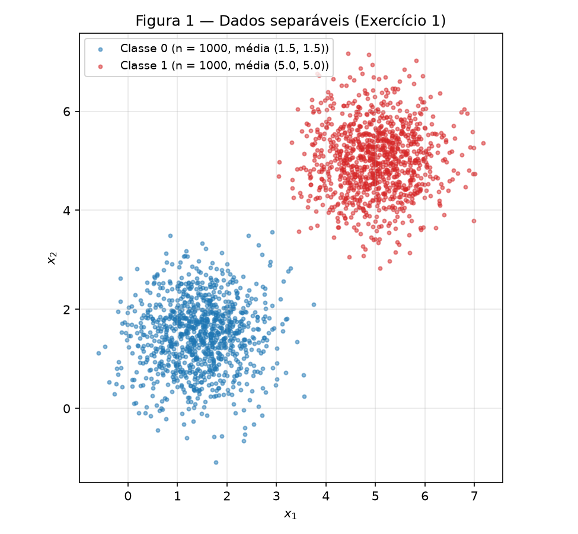
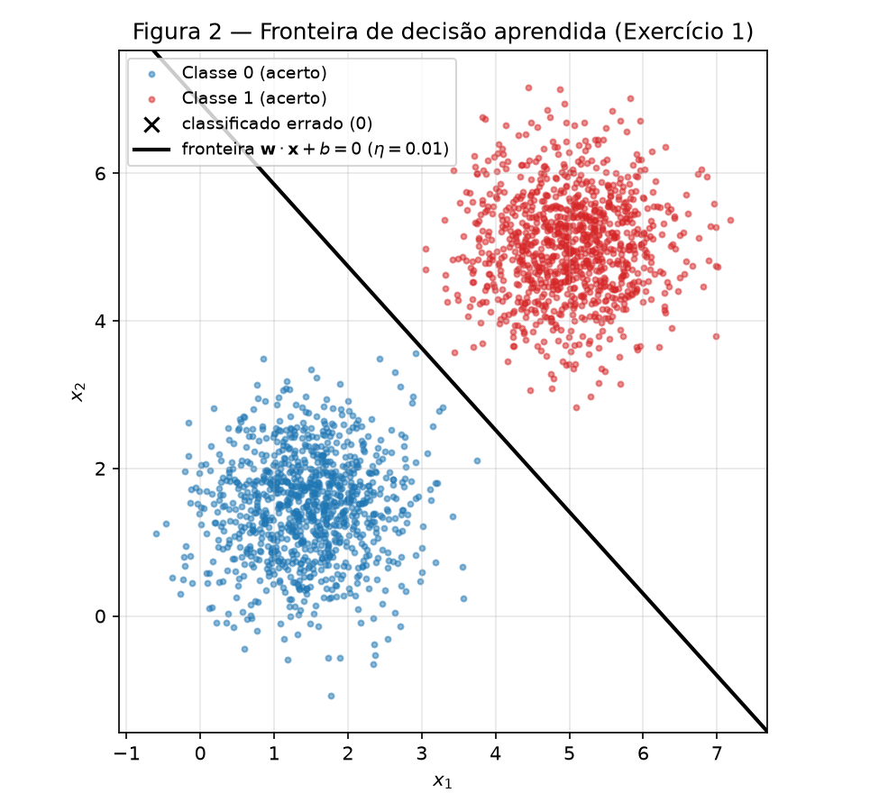
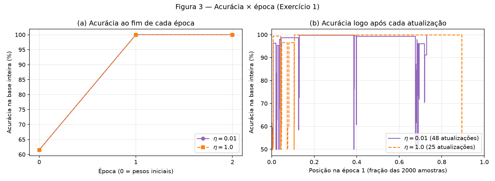
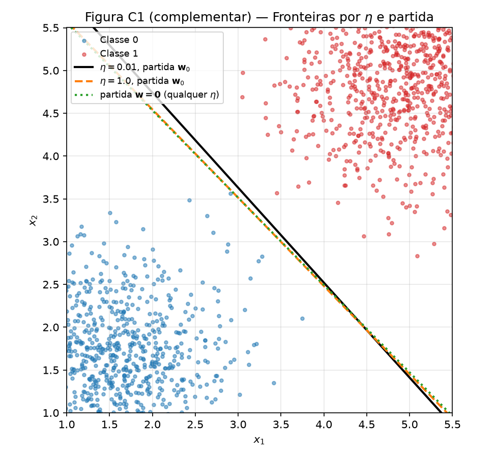
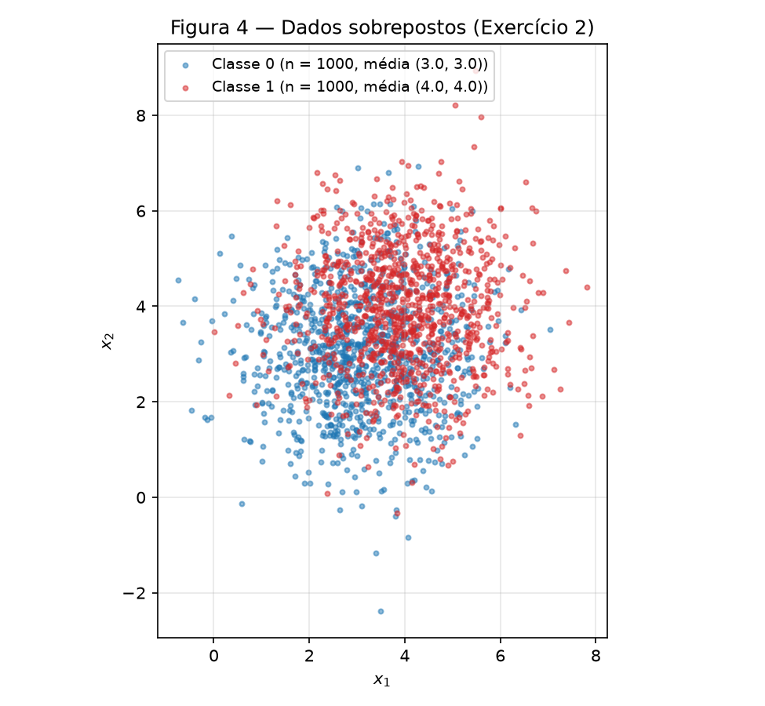
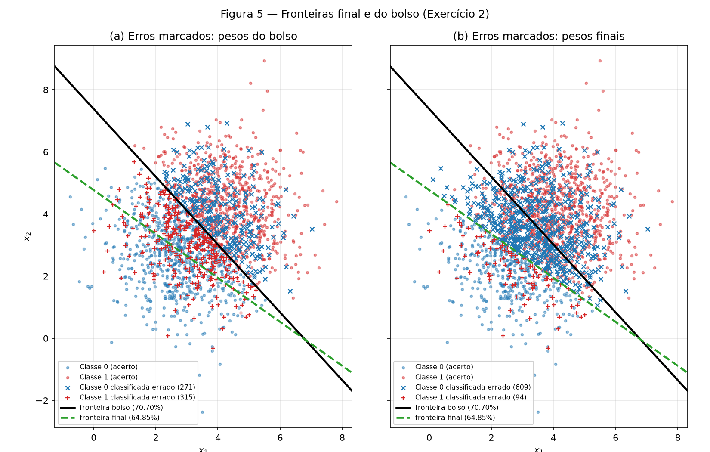
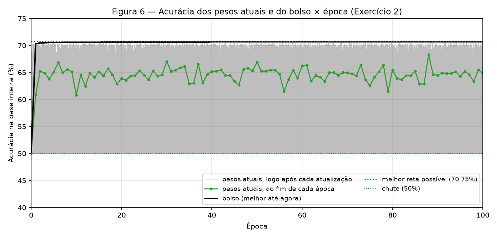
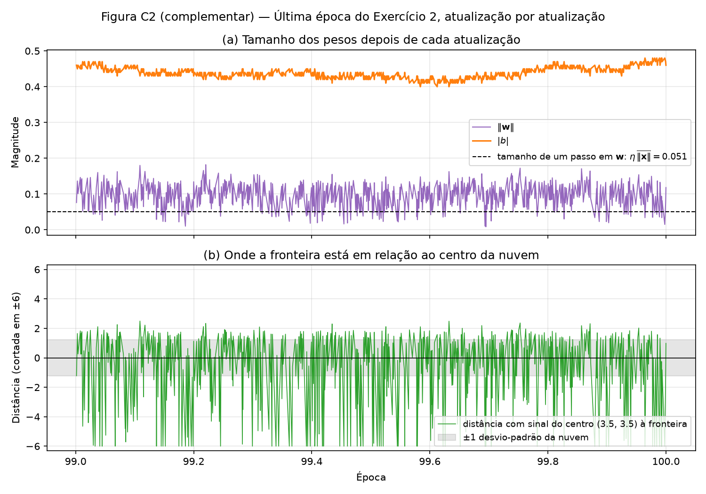

# 2. Perceptron — Separabilidade: quando converge e como falha

!!! info "Como reproduzir"

    ```bash
    python3 -m pip install -r requirements.txt
    python3 docs/exercises/perceptron/code/main.py
    ```

    `main.py` cria **um único** gerador `rng = np.random.default_rng(42)` e o usa, nessa ordem,
    para os dados do Exercício 1, o $\mathbf{w}$ inicial do Exercício 1, os dados do Exercício 2 e o
    $\mathbf{w}$ inicial do Exercício 2. As execuções extras (outro $\eta$, partida do zero, mais
    épocas) reaproveitam esses mesmos pesos iniciais. O script regrava todas as figuras em
    `figures/` e todos os números em `code/results.json` (≈ 30 s). Todo número citado neste
    relatório vem desse arquivo.

    O perceptron (degrau, predição, regra de atualização e laço de treino) está escrito à mão em
    NumPy em `code/perceptron.py`. Nenhuma biblioteca fornece o modelo; o scikit-learn não é usado.

| Arquivo | Conteúdo |
|---------|----------|
| `code/perceptron.py` | o perceptron do zero: `step`, `Perceptron(w_init, eta)`, `fit` com o bolso |
| `code/main.py` | ponto de entrada: seed única, roda os 2 exercícios, grava `results.json` |
| `code/ex1_separable.py` | Exercício 1: dados, treino com $\eta = 0.01$ e $1.0$, partida do zero, Figuras 1–3 e C1 |
| `code/ex2_overlap.py` | Exercício 2: dados, treino com bolso, Figuras 4–6 e C2, verificações do item D |

??? example "Código — `perceptron.py` (o modelo usado nos dois exercícios)"

    ``` python
    --8<-- "docs/exercises/perceptron/code/perceptron.py"
    ```

??? example "Código — `main.py`"

    ``` python
    --8<-- "docs/exercises/perceptron/code/main.py"
    ```

## Abordagem e desafios

**Abordagem.** Uma única classe `Perceptron` serve aos dois exercícios, sem nenhuma alteração. O
`fit` percorre as amostras uma a uma, calcula $\hat y = \text{step}(\mathbf{w}\cdot\mathbf{x} + b)$ e
aplica $\mathbf{w} \leftarrow \mathbf{w} + \eta(y - \hat y)\mathbf{x}$, $b \leftarrow b + \eta(y - \hat y)$.
O laço para numa época sem nenhuma atualização ou em 100 épocas. Ao fim de cada época, mede a
acurácia na base inteira. O bolso (*pocket*) também fica dentro do `fit`: depois de cada atualização,
mede a acurácia na base inteira e guarda $(\mathbf{w}, b)$ se ela for a melhor até então. No
Exercício 1 isso só acompanha a convergência; no Exercício 2 é a resposta.

**Desafios.**

* **Ordem das amostras.** A geração produz 1000 pontos da classe 0 seguidos de 1000 da classe 1.
  Embaralhei essa ordem **uma vez**, com o `rng`, e a mantive fixa em todas as épocas e execuções.
  Assim, no item 1D, a execução com $\eta = 1.0$ difere da principal só em $\eta$: mesmos dados,
  mesmo $\mathbf{w}$ inicial, mesma ordem.
* **O resultado final do Exercício 2 depende de onde a época termina.** O enunciado antecipa
  acurácia perto de 50% para os pesos finais. Com a ordem embaralhada obtive 64.85%; apresentando as
  classes em bloco, como saem da geração, obtive 50.25%. As duas coisas são a mesma oscilação vista
  em momentos diferentes. O item 2D explica e mostra as duas.
* **Custo do bolso.** Avaliar a base inteira depois de cada uma das 76 620 atualizações do Exercício 2
  é o passo mais caro do treino, mas leva cerca de 1 s.

---

## Exercício 1

**Dados separáveis: o caso para o qual o perceptron foi feito.**

??? example "Código completo — `ex1_separable.py`"

    ``` python
    --8<-- "docs/exercises/perceptron/code/ex1_separable.py"
    ```

### A — Gere os dados

`make_data(rng, ...)` sorteia 1000 pontos por classe com `rng.multivariate_normal`: classe 0 com média
$(1.5, 1.5)$ e classe 1 com média $(5, 5)$, as duas com covariância
$\begin{bmatrix} 0.5 & 0 \\ 0 & 0.5 \end{bmatrix}$. As médias amostrais ficaram em $(1.450,\ 1.473)$ e
$(5.010,\ 5.013)$. A distância entre as médias ($\approx 4.95$) é cerca de 7 desvios-padrão
($\sqrt{0.5} \approx 0.71$).


/// caption
**Figura 1** — Os 2000 pontos do Exercício 1, uma cor por classe.
///

### B — Implemente o perceptron

A implementação está em `perceptron.py` (código acima):

* **Predição:** `step(z)` devolve 1 se $z \ge 0$ e 0 caso contrário, e $\hat y = \text{step}(\mathbf{w}\cdot\mathbf{x} + b)$.
* **Atualização:** com rótulos em $\{0, 1\}$, o erro $y - \hat y$ vale 0 num acerto (nenhuma atualização),
  $+1$ num falso negativo (soma $\eta\mathbf{x}$ e aumenta $b$) e $-1$ num falso positivo (subtrai
  $\eta\mathbf{x}$ e diminui $b$). A forma $\mathbf{w} \leftarrow \mathbf{w} + \eta\,y\,\mathbf{x}$ é da
  convenção $\pm 1$; com $y = 0$ ela nunca corrigiria um falso positivo.
* **Inicialização:** $\mathbf{w}_0$ = `rng.normal(0, 0.01, size=2)` = $(0.009914,\ -0.008270)$ e $b_0 = 0$.
  O vetor é sorteado fora da classe e passado a ela, para que a execução com $\eta = 1.0$ parta do mesmo ponto.
* **Taxa de aprendizado:** $\eta = 0.01$.
* **Parada:** uma época inteira sem nenhuma atualização, ou 100 épocas. A acurácia na base inteira é
  registrada ao fim de cada época.

### C — Treine e meça

| Item | Valor |
|------|-------|
| $\mathbf{w}$ final | $(0.031891,\ 0.028736)$ |
| $b$ final | $-0.200000$ |
| Épocas | **2**: 48 atualizações na época 1 e nenhuma na época 2, que confirma a convergência |
| Acurácia final | **100.00%** (2000 de 2000) |
| Acurácia dos pesos iniciais | 61.50% |

A fronteira $0.031891\,x_1 + 0.028736\,x_2 - 0.2 = 0$ fica a 4.66 da origem, no vão entre as nuvens.


/// caption
**Figura 2** — Fronteira $\mathbf{w}\cdot\mathbf{x} + b = 0$ aprendida com $\eta = 0.01$. Nenhum ponto é classificado errado; o marcador de erro existe na legenda, mas tem 0 pontos.
///


/// caption
**Figura 3** — (a) Acurácia na base inteira ao fim de cada época, com a época 0 = pesos iniciais. (b) Acurácia logo após cada atualização durante a época 1. Depois da última atualização (73% da época para $\eta = 0.01$, 89% para $\eta = 1.0$), nada mais muda.
///

### D — Análise

**Por que converge rápido.** A regra só age quando erra: num acerto, $y - \hat y = 0$ e os pesos não
mudam. Cada erro empurra a fronteira na direção que corrige aquele ponto. Como as nuvens estão a
~7 desvios-padrão uma da outra, existe um vão largo onde qualquer reta acerta tudo. Assim que a
fronteira cai nesse vão, todo ponto passa a ser acerto, e não há mais o que atualizar. O número de
atualizações por época foi **48 → 0** ($\eta = 0.01$) e **25 → 0** ($\eta = 1.0$). A última
atualização aconteceu na amostra 1457 de 2000 da primeira época; as 543 amostras seguintes e a época 2
inteira passaram sem erro. O teorema de convergência dá um teto para isso (item 2D): com a reta de
margem máxima destes dados ($\gamma = 0.235$, achada por varredura) e $\lVert\mathbf{x}\rVert \le R = 9.12$,
o limite é de 32 898 erros. É um limite folgado, mas finito; na prática foram 25 a 48. A Figura 3(b)
mostra que, *antes* de cair no vão, uma atualização isolada às vezes derruba a acurácia de 99% para
50%. É o mesmo efeito que, no Exercício 2, não para nunca.

**Reexecução com $\eta = 1.0$** (mesmos dados, ordem e $\mathbf{w}_0$):

| | $\eta = 0.01$ | $\eta = 1.0$ |
|:--|:--:|:--:|
| Épocas | 2 | 2 |
| Atualizações | 48 | 25 |
| Acurácia final | 100.00% | 100.00% |
| $\mathbf{w}$, $b$ | $(0.031891,\ 0.028736)$, $-0.20$ | $(1.717344,\ 1.664585)$, $-11.0$ |
| Direção $\mathbf{w}/\lVert\mathbf{w}\rVert$ | $(0.7429,\ 0.6694)$ | $(0.7181,\ 0.6960)$ |
| Distância da fronteira à origem | 4.659 | 4.599 |

As duas chegam a 100%, mas por fronteiras diferentes: as direções diferem em **2.09°** (Figura C1).
**O que $\eta$ controla** fica claro desenrolando a regra. Depois de $t$ atualizações com erros $e_s$:

$$
\begin{aligned}
\mathbf{w}_t &= \mathbf{w}_0 + \eta\sum_{s<t} e_s\,\mathbf{x}_s, & b_t &= \eta\sum_{s<t} e_s \\
\Longrightarrow\quad \frac{\mathbf{w}_t}{\eta} &= \frac{\mathbf{w}_0}{\eta} + \sum_{s<t} e_s\,\mathbf{x}_s, & \frac{b_t}{\eta} &= \sum_{s<t} e_s .
\end{aligned}
$$

A predição $\text{step}(\mathbf{w}\cdot\mathbf{x} + b)$ não muda se $(\mathbf{w}, b)$ for dividido por
$\eta > 0$. Logo, treinar com $\eta$ a partir de $\mathbf{w}_0$ é **exatamente** o mesmo que treinar
com $\eta = 1$ a partir de $\mathbf{w}_0/\eta$. O $\eta$ não regula o "tamanho do passo" da fronteira:
regula **o peso da inicialização aleatória frente às atualizações**.

* Com $\eta = 0.01$, a partida efetiva é $\mathbf{w}_0/\eta = (0.99,\ -0.83)$, de norma 1.29, comparável a
  uma amostra ($\overline{\lVert\mathbf{x}\rVert} = 4.65$) e apontando para $(+, -)$. As primeiras
  atualizações gastam esforço desfazendo essa orientação (48 em vez de 25), e a direção final guarda
  um resquício dela: ficou girada para o lado de $x_1$.
* Com $\eta = 1.0$, a partida efetiva é o próprio $\mathbf{w}_0$, de norma 0.013, desprezível diante de
  $\lVert\mathbf{x}\rVert \approx 4.65$. A execução praticamente coincide com a partida do zero: as
  mesmas 25 atualizações, o mesmo $b = -11$ e uma direção a só 0.31° dela.

**Partindo de $\mathbf{w} = \mathbf{0}$, $b = 0$, $\eta$ não tem efeito nenhum.** Sejam
$(\mathbf{w}_t, b_t)$ os pesos depois de $t$ amostras com $\eta_1$ e $(\mathbf{w}'_t, b'_t)$ com $\eta_2$,
os dois a partir de $(\mathbf{0}, 0)$ e com a mesma sequência de amostras. Seja $c = \eta_2/\eta_1 > 0$.
Afirmo que $(\mathbf{w}'_t, b'_t) = c\,(\mathbf{w}_t, b_t)$ para todo $t$. Por indução:

* **Base** ($t = 0$): $(\mathbf{0}, 0) = c\,(\mathbf{0}, 0)$.
* **Passo.** Suponha que vale em $t$ e seja $\mathbf{x}$ a próxima amostra. A entrada líquida é
  $z'_t = \mathbf{w}'_t\cdot\mathbf{x} + b'_t = c\,(\mathbf{w}_t\cdot\mathbf{x} + b_t) = c\,z_t$.
  Como $c > 0$, $z'_t \ge 0 \iff z_t \ge 0$, então $\hat y'_t = \hat y_t$ e o erro é o mesmo,
  $e'_t = e_t$. Portanto
  $\mathbf{w}'_{t+1} = c\,\mathbf{w}_t + \eta_2 e_t\mathbf{x} = c\,(\mathbf{w}_t + \eta_1 e_t\mathbf{x}) = c\,\mathbf{w}_{t+1}$
  e, do mesmo modo, $b'_{t+1} = c\,b_t + \eta_2 e_t = c\,b_{t+1}$. $\blacksquare$

Consequências: as duas execuções fazem as mesmas predições em todo passo, logo as mesmas atualizações
e a mesma época sem erro, ou seja, **o mesmo número de épocas**. A fronteira
$\{\mathbf{x} : c(\mathbf{w}\cdot\mathbf{x} + b) = 0\}$ é **a mesma reta**. Na fórmula desenrolada acima
isso é imediato: com $\mathbf{w}_0 = \mathbf{0}$, a partida efetiva $\mathbf{w}_0/\eta$ é zero para todo
$\eta$. Conferi numericamente: partindo do zero, $\eta = 0.01$ e $\eta = 1$ fazem as mesmas 25
atualizações em 2 épocas, com $\mathbf{w}' / \mathbf{w} = (100.000,\ 100.000)$ e $b'/b = 100.000$
($b = -0.11$ contra $-11$). É por isso que o item B proíbe a partida do zero: o experimento com $\eta$
não teria o que medir.


/// caption
**Figura C1 (complementar)** — Zoom no vão entre as nuvens: as fronteiras de $\eta = 0.01$ e $\eta = 1.0$ (mesma partida $\mathbf{w}_0$) e a da partida do zero, que é a mesma para qualquer $\eta$. A de $\eta = 1.0$ quase coincide com a do zero; a de $\eta = 0.01$ fica girada 2.09°.
///

---

## Exercício 2

**Dados sobrepostos: o caso que o perceptron não resolve.**

??? example "Código completo — `ex2_overlap.py`"

    ``` python
    --8<-- "docs/exercises/perceptron/code/ex2_overlap.py"
    ```

### A — Gere os dados

A mesma `make_data` do Exercício 1, agora com médias $(3, 3)$ e $(4, 4)$ e covariância
$\begin{bmatrix} 1.5 & 0 \\ 0 & 1.5 \end{bmatrix}$, 1000 pontos por classe, embaralhados uma vez. As
médias amostrais ficaram em $(3.072,\ 3.019)$ e $(3.955,\ 3.955)$. Agora as médias estão a 1.41 de
distância e o desvio-padrão é 1.22: as nuvens se sobrepõem quase inteiras.


/// caption
**Figura 4** — Os 2000 pontos do Exercício 2, uma cor por classe.
///

### B — Treine guardando os melhores pesos

O mesmo `Perceptron`, sem alteração, com $\eta = 0.01$, limite de 100 épocas e
$\mathbf{w}_0$ = `rng.normal(0, 0.01, size=2)` = $(-0.014556,\ -0.004621)$, $b_0 = 0$. O laço nunca
para: fez as 100 épocas, com 822 atualizações na primeira e entre 739 e 794 em cada uma das outras
(76 620 no total).

| | $\mathbf{w}$ | $b$ | Acurácia |
|:--|:--:|:--:|:--:|
| **Pesos finais** (fim da época 100) | $(0.068178,\ 0.096455)$ | $-0.46$ | **64.85%** |
| **Bolso** (melhor já visto, época 40) | $(0.070947,\ 0.065048)$ | $-0.48$ | **70.70%** |

Para comparação, a melhor reta possível nestes 2000 pontos (varrendo 1440 direções e todos os limiares)
acerta **70.75%**, e o bolso fica a 1 ponto dela. A regra de Bayes com os parâmetros verdadeiros
($x_1 + x_2 \ge 7$) acerta 70.20% desta amostra e $\Phi(0.577) = 71.8\%$ em média. O "cerca de 73%" do
enunciado é dessa ordem.

### C — Figuras


/// caption
**Figura 5** — As duas fronteiras sobre os dados, com os erros marcados ($\times$ = classe 0 prevista como 1, $+$ = classe 1 prevista como 0). (a) Erros da fronteira do bolso: 271 + 315. (b) Erros da fronteira final: 609 + 94.
///


/// caption
**Figura 6** — Acurácia dos pesos atuais ao fim de cada época (verde) e do bolso (preto) por época. A faixa cinza é a acurácia logo após cada uma das 76 620 atualizações: os pesos atuais varrem de ~50% a ~70% o tempo todo.
///

### D — Análise

**A diferença entre os pesos finais e o bolso.** A fronteira do bolso corta a nuvem pelo meio: passa a
0.04 do centro $(3.5,\ 3.5)$, a 4.99 da origem, e prevê classe 1 para 47.8% dos pontos. A fronteira
final passa 0.98 **abaixo** do centro, a 3.89 da origem. Ela prevê classe 1 para 75.75% dos pontos e
erra 609 dos 1000 da classe 0 (Figura 5b). Mas o laço não "deixou" a fronteira ali: ela estava só
passando. Na última época, a distância do centro à fronteira variou de 1.8 de um lado a quase 9 do
outro (percentis 5% e 95%). Em 55% das atualizações, o centro ficou a mais de 1 desvio-padrão da reta.
Ao longo das 100 épocas, a acurácia logo após cada atualização teve mediana de 60.8%, e 11% das
atualizações a deixaram em 50% ou menos (Figura 6). Os pesos finais são uma foto tirada no meio dessa
oscilação.

**Por que oscila: $b$ anda pouco e $\mathbf{w}$ anda muito.** A cada erro, $b$ muda $\eta = 0.01$, e
$\mathbf{w}$ muda $\eta\,\mathbf{x}$, cujo tamanho médio é $0.01 \times 5.11 = 0.051$. A fronteira fica a
$|b|/\lVert\mathbf{w}\rVert$ da origem. Para cortar a nuvem, que está a ~4.95 da origem, é preciso
$\lVert\mathbf{w}\rVert \approx |b|/4.95$. Como $|b|$ ficou preso perto de 0.45 (entre 0.40 e 0.48 na
última época), $\lVert\mathbf{w}\rVert$ precisa valer ~0.09. **Um único passo, 0.051, é mais da metade
disso.**

* Num falso negativo, $\mathbf{w}$ ganha ~0.05 na direção da diagonal, $\lVert\mathbf{w}\rVert$ vai de
  ~0.09 a ~0.14 e a fronteira salta de ~5.0 para ~3.2 da origem. É um salto de ~1.8, maior que o
  desvio-padrão da nuvem (1.22).
* Num falso positivo acontece o contrário: $\lVert\mathbf{w}\rVert$ pode cair quase a zero (chegou a
  0.008), e a fronteira é jogada para $0.45/0.008 \approx 56$ da origem, longe da nuvem inteira. Tudo
  vira classe 0, e a acurácia vai a 50%.

E $|b|$ não cresce para tornar os passos relativamente pequenos: ele sobe 0.01 a cada falso negativo e
desce 0.01 a cada falso positivo. Com as classes sobrepostas, os dois tipos de erro continuam chegando
em proporções parecidas, então $b$ só vagueia (Figura C2a). A escala de $\mathbf{w}$ fica presa à de um
único passo, e a reta nunca se acomoda.

**Mais uma evidência: a ordem das amostras.** Com as classes em bloco (os 1000 pontos da classe 0, depois
os 1000 da classe 1; mesmos dados, mesmo $\mathbf{w}_0$), a oscilação vira uma alternância. Na última
época houve só 4 atualizações. Dois erros, nas amostras 1 e 4 do bloco da classe 0, bastaram para
jogar a reta para longe: ao fim desse bloco, o modelo previa classe 0 para 100% dos pontos. Outros dois,
nas amostras 1 e 49 do bloco da classe 1, levaram a reta para o outro extremo ("tudo classe 1"). Toda
época termina no bloco da classe 1, então os pesos finais preveem classe 1 para 99.75% dos pontos e
acertam **50.25%**, o número que o enunciado antecipa. O bolso, nesse caso, fica em 69.25%.


/// caption
**Figura C2 (complementar)** — As 757 atualizações da época 100. (a) $\lVert\mathbf{w}\rVert$ oscila entre 0.008 e 0.18, na mesma escala de um único passo (0.051), enquanto $|b|$ quase não sai de 0.45. (b) Distância com sinal do centro da nuvem à fronteira: a reta atravessa a nuvem de um lado a outro várias vezes por época.
///

**Figura 3 × Figura 6: o que o teorema garante.** O teorema de convergência do perceptron (Novikoff,
1962) diz o seguinte. Se existe uma reta que separa as classes com margem $\gamma > 0$ e todo ponto
(aumentado com 1 para o viés) tem norma $\le R$, então o perceptron faz **no máximo $(R/\gamma)^2$
erros** e para, com 100% de acurácia no treino. Partindo do zero, com o viés incluído, isso vale
$(R^2+1)(1+b^{*2})/\gamma^2$. No Exercício 1 a hipótese vale ($\gamma = 0.235$), e a curva da Figura 3
se acomoda em 100% depois de 25 a 48 erros. Aqui a hipótese quebrada é a **separabilidade linear**:
não existe $\gamma > 0$, porque a melhor reta ainda erra 29.25% dos pontos. Sem margem, o teorema não
dá limite nenhum, e o laço faz ~765 atualizações em toda época, sem tendência de queda (Figura 6). Os
pesos continuam limitados ($\lVert\mathbf{w}\rVert \le 0.18$ na última época), mas ficam ciclando em vez
de convergir.

**Mais épocas resolvem? Não.** A regra atualiza toda vez que erra, e qualquer reta erra pelo menos
585 dos 2000 pontos. Então toda época, por mais tardia, traz centenas de atualizações, cada uma do
tamanho de meio $\lVert\mathbf{w}\rVert$. Nada na regra diminui com o tempo, e ela não guarda memória de
quais pesos foram bons: o processo da época 1000 é estatisticamente o mesmo da época 100.

**Um $\eta$ menor resolve? Também não.** Pela identidade do item 1D,
$\mathbf{w}_t/\eta = \mathbf{w}_0/\eta + \sum_s e_s\mathbf{x}_s$ e $b_t/\eta = \sum_s e_s$. Diminuir
$\eta$ encolhe $\mathbf{w}$, $b$ e os passos **na mesma proporção**, então a razão passo /
$\lVert\mathbf{w}\rVert$, que é o que faz a reta saltar, não muda. Partindo do zero, a sequência de
fronteiras seria idêntica para qualquer $\eta$. Partindo de $\mathbf{w}_0 \ne \mathbf{0}$, um $\eta$
menor só aumenta o peso da inicialização aleatória nas primeiras atualizações.

Rodei as duas variações só para confirmar, mesmos dados e mesmo $\mathbf{w}_0$:

| Variação | Acurácia final | Faixa nas últimas 50 épocas | Atualizações por época | Bolso |
|:--|:--:|:--:|:--:|:--:|
| $\eta = 0.01$, 100 épocas (principal) | 64.85% | 61.45%–68.30% | 766 | 70.70% |
| $\eta = 0.01$, **1000 épocas** | 65.05% | 54.55%–66.90% | 766 | 70.75% |
| **$\eta = 0.001$**, 100 épocas | 68.25% | 62.80%–68.25% | 766.5 | 70.70% |
| **$\eta = 0.001$**, **1000 épocas** | 65.15% | 57.75%–68.30% | 765 | 70.75% |

Em todas as variações a oscilação continua, e só o
bolso entrega ~70.7%. O que resolveria seria mudar o algoritmo, não os hiperparâmetros: guardar o melhor
(o bolso), fazer a média dos pesos ao longo do treino (*averaged perceptron*), usar uma taxa que decai
com o tempo, ou trocar a regra por uma perda que tem mínimo, como a regressão logística.

---

## Referências

* Enunciado: [2. Perceptron — ANN & DL 2026.2](https://insper.github.io/ann-dl/2026.2/exercises/perceptron/){:target="_blank"}.
* F. Rosenblatt. *The perceptron: a probabilistic model for information storage and organization in the brain*. Psychological Review, 1958.
* A. B. J. Novikoff. *On convergence proofs for perceptrons*. Symposium on the Mathematical Theory of Automata, 1962.
* S. I. Gallant. *Perceptron-based learning algorithms*. IEEE Transactions on Neural Networks, 1990 (algoritmo do bolso).

## Resumo dos resultados

| # | Item | Valor |
|:-:|------|-------|
| 1 | Exercício 1 — $\mathbf{w}$ e $b$ finais | $\mathbf{w} = (0.031891,\ 0.028736)$; $b = -0.20$ ($\eta = 0.01$) |
| 2 | Exercício 1 — épocas até convergir | **2** (48 atualizações na época 1; a época 2 passou sem nenhuma) |
| 3 | Exercício 1 — acurácia final | **100.00%** |
| 4 | Exercício 1 — épocas e acurácia final com $\eta = 1.0$ | **2 épocas** (25 atualizações), **100.00%**; direção de $\mathbf{w}$ girada 2.09° em relação a $\eta = 0.01$ |
| 5 | Exercício 2 — $\mathbf{w}$ e $b$ finais | $\mathbf{w} = (0.068178,\ 0.096455)$; $b = -0.46$ |
| 6 | Exercício 2 — acurácia dos pesos finais | **64.85%** (50.25% com as classes em bloco) |
| 7 | Exercício 2 — acurácia dos pesos do bolso | **70.70%**: $\mathbf{w} = (0.070947,\ 0.065048)$, $b = -0.48$ (melhor reta possível: 70.75%) |
| 8 | Exercício 2 — época em que ocorreu o melhor do bolso | **40** |
