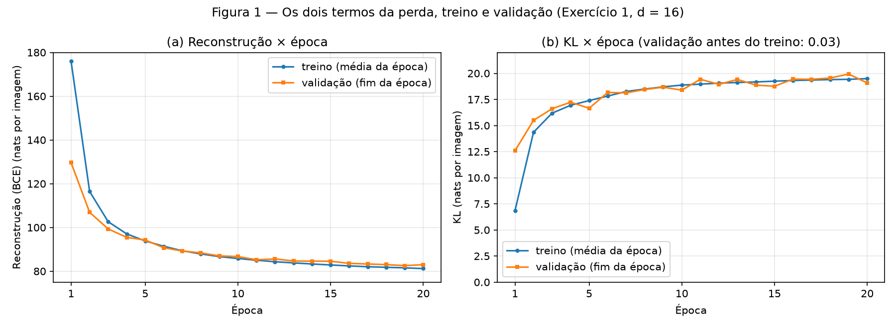
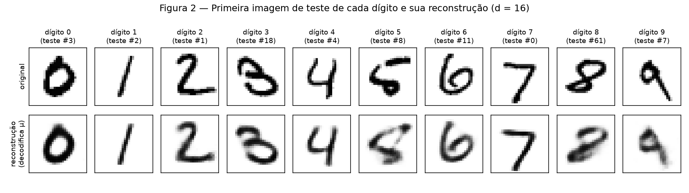
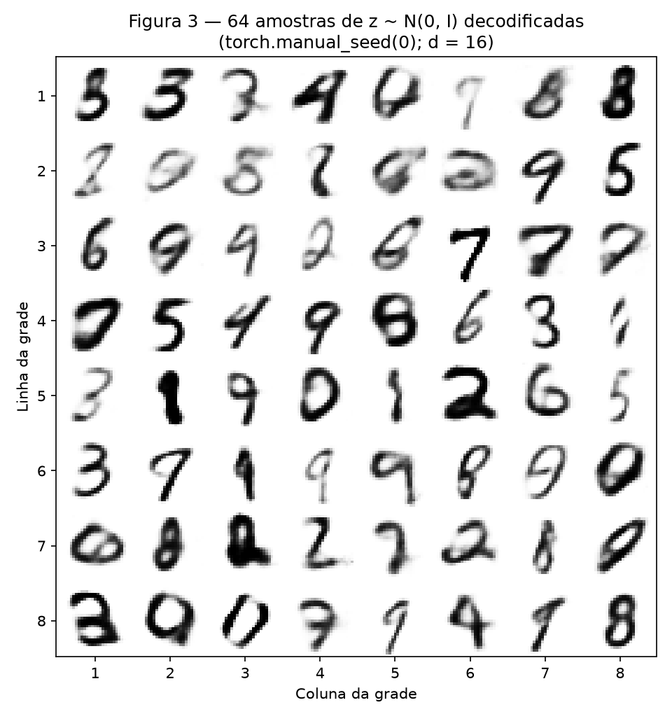
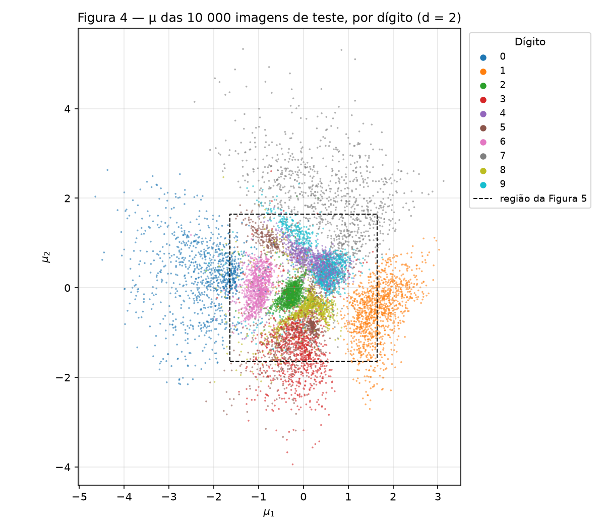
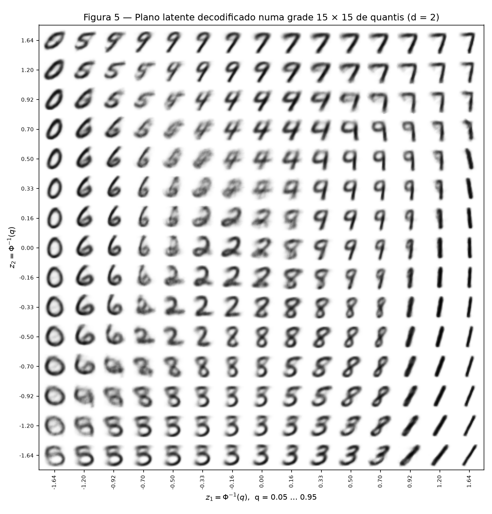
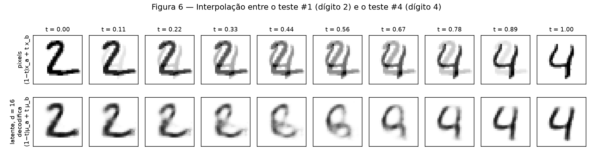
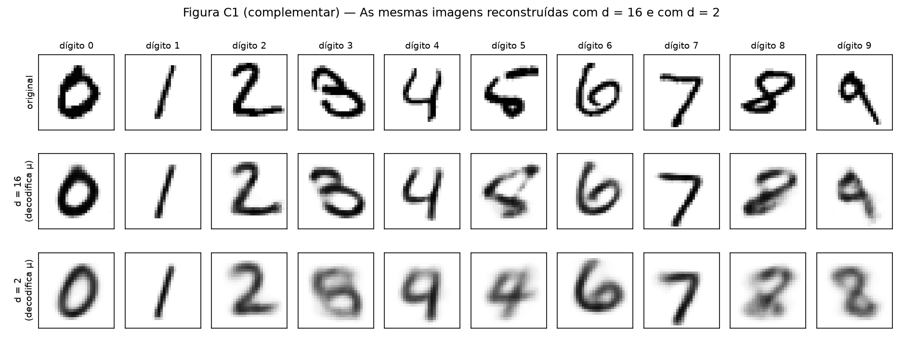

# 4. VAE — O cabo de guerra dentro da perda

!!! info "Como reproduzir"

    ```bash
    python3 -m pip install -r requirements.txt
    python3 docs/exercises/vae/code/main.py
    ```

    `main.py` baixa o MNIST na primeira execução (para `code/data/`, fora do git), treina o VAE com
    $d = 16$ e com $d = 2$ na CPU e regrava as figuras em `figures/` e todos os números em
    `code/results.json` (≈ 75 s num M2). Cada modelo é construído logo depois de
    `torch.manual_seed(42)`, e a divisão usa o gerador do enunciado. Rodando duas vezes, o
    `results.json` sai idêntico. Todo número citado neste relatório vem desse arquivo.

    Se o download falhar com `CERTIFICATE_VERIFY_FAILED` (Python do python.org no macOS), rode o
    `Install Certificates.command` da pasta do Python ou use
    `SSL_CERT_FILE=$(python3 -m certifi) python3 docs/exercises/vae/code/main.py`.

    O autograd do PyTorch calcula os gradientes. A reparametrização, os dois termos da perda e a
    amostragem estão escritos à mão em `code/vae.py`; não uso classe de VAE pronta nem
    `torch.distributions`. O `scipy` só entra no $\Phi^{-1}$ da Figura 5 e na busca de vizinhos da
    análise 2E.

| Arquivo | Conteúdo |
|---------|----------|
| `code/vae.py` | o modelo, `reparameterize`, `reconstruction_term`, `kl_term`, `sample_prior` e o laço de treino |
| `code/data.py` | MNIST com a divisão 50 000 / 10 000 do enunciado e o teste oficial |
| `code/main.py` | ponto de entrada: treina os dois modelos e grava `results.json` |
| `code/ex1_mnist.py` | Exercício 1: $d = 16$, Figuras 1–3 e as medidas da análise 1E |
| `code/ex2_latent2d.py` | Exercício 2: $d = 2$, Figuras 4–6, Figura C1 e as medidas da análise 2E |

??? example "Código — `vae.py` (modelo, perda, amostragem e treino)"

    ``` python
    --8<-- "docs/exercises/vae/code/vae.py"
    ```

??? example "Código — `data.py` e `main.py`"

    ``` python
    --8<-- "docs/exercises/vae/code/data.py"
    ```

    ``` python
    --8<-- "docs/exercises/vae/code/main.py"
    ```

---

## Exercício 1

**Um VAE no MNIST.**

??? example "Código completo — `ex1_mnist.py`"

    ``` python
    --8<-- "docs/exercises/vae/code/ex1_mnist.py"
    ```

### A — Carregue e divida os dados

`load_mnist()` carrega o MNIST do torchvision com `transforms.ToTensor()` e chama `random_split`
exatamente como no enunciado: 50 000 imagens de treino e 10 000 de validação, com
`generator=torch.Generator().manual_seed(42)`. As 10 000 imagens oficiais de teste são o conjunto de
teste. Para não passar imagem por imagem pelo `ToTensor`, divido o tensor `uint8` inteiro por 255,
que é o que o `ToTensor` faz, e achato cada imagem num vetor de 784 pixels em $[0, 1]$. Um `assert`
confere numa imagem que o resultado é idêntico ao do `ToTensor`.

O teste só aparece **depois** do treino de cada modelo, para os números finais e as figuras pedidas
sobre ele. Durante o treino, tudo que é registrado vem do treino e da validação. Não há decisões de
treino a tomar: arquitetura, otimizador e orçamento são fixos.

### B — Construa o modelo

| Parte | Camadas |
|-------|---------|
| Codificador | $784 \to 512 \to 256$, ReLU depois de cada uma |
| Cabeças | duas lineares $256 \to d$: uma para $\boldsymbol\mu$, outra para $\log\boldsymbol\sigma^2$ |
| Decodificador | $d \to 256 \to 512 \to 784$, ReLU nas ocultas, sigmoide na saída |

com $d = 16$. As partes específicas do VAE, todas em `vae.py`:

* **Reparametrização** (`reparameterize`): $\mathbf{z} = \boldsymbol\mu + \boldsymbol\sigma \odot \boldsymbol\varepsilon$,
  com $\boldsymbol\varepsilon \sim \mathcal N(\mathbf 0, I)$ e $\boldsymbol\sigma = \exp(\tfrac12\log\boldsymbol\sigma^2)$.
  O sorteio fica em $\boldsymbol\varepsilon$, que não depende dos parâmetros, então o gradiente passa
  por $\boldsymbol\mu$ e $\boldsymbol\sigma$. A cabeça prevê $\log\sigma^2$, que pode ser qualquer número
  real, em vez de $\sigma$, que teria de ser positivo.
* **Reconstrução** (`reconstruction_term`): `F.binary_cross_entropy(x_hat, x, reduction="sum")` dividido
  pelo número de imagens do lote. É a BCE somada nos 784 pixels, em média por imagem, ou seja,
  $-\log p(\mathbf x \mid \mathbf z)$ com cada pixel Bernoulli.
* **KL em forma fechada** (`kl_term`): $\tfrac12\sum_{i=1}^{d}(\mu_i^2 + \sigma_i^2 - 1 - \log\sigma_i^2)$,
  média nas imagens. Ela sai de
  $\mathrm{KL} = \mathbb E_q[\log q - \log p] = \sum_i\big(-\tfrac12\log\sigma_i^2 - \tfrac12 + \tfrac12(\mu_i^2 + \sigma_i^2)\big)$,
  porque $\mathbb E_q[(z_i-\mu_i)^2/\sigma_i^2] = 1$ e $\mathbb E_q[z_i^2] = \mu_i^2 + \sigma_i^2$.
* **Perda:** $L = \text{reconstrução} + \beta\cdot\text{KL}$, com $\beta = 1$ e os dois termos em nats por imagem.
* **Amostragem** (`sample_prior`): $\mathbf z \sim \mathcal N(\mathbf 0, I)$ pelo gerador global, decodificado.

### C — Treine

Adam com taxa $10^{-3}$, lotes de 128, 20 épocas (`train` em `vae.py`). O treino registra a média de
cada termo ao longo da época. A validação é medida ao fim de cada época, com um $\mathbf z$ sorteado
por imagem, como no ELBO. O ruído da avaliação vem de um gerador próprio, de seed fixa, para não
mexer no gerador que embaralha os lotes. Também medi a validação antes da primeira época (época 0).

| Época | Reconstrução, treino | KL, treino | Reconstrução, validação | KL, validação |
|:--:|:--:|:--:|:--:|:--:|
| 0 (antes) | — | — | 544.71 | 0.03 |
| 1 | 175.92 | 6.84 | 129.58 | **12.59** |
| 2 | 116.44 | 14.36 | 106.92 | 15.49 |
| 3 | 102.63 | 16.18 | 99.34 | 16.61 |
| 5 | 93.84 | 17.39 | 94.26 | 16.65 |
| 10 | 85.81 | 18.87 | 86.69 | 18.39 |
| 20 | 81.20 | 19.49 | 83.00 | **19.08** |

**Teste, nats por imagem ($d = 16$):** reconstrução **82.31**, KL **19.12** e
**$-$ELBO = 101.43**. O enunciado espera ~81 e ~20. O treino levou 37 s na CPU.


/// caption
**Figura 1** — (a) Reconstrução e (b) KL por época, no treino (média da época) e na validação (fim da época). A reconstrução cai de 176 para 81 nats enquanto o KL sobe de 7 para 19.
///

### D — Reconstruções e amostras


/// caption
**Figura 2** — Primeira imagem de teste de cada dígito (em cima) e sua reconstrução decodificando $\boldsymbol\mu$, sem sortear $\mathbf z$ (embaixo).
///


/// caption
**Figura 3** — Grade 8 × 8 de imagens decodificadas de $\mathbf z \sim \mathcal N(\mathbf 0, I)$, sorteadas logo depois de `torch.manual_seed(0)`.
///

### E — Análise

**Por que o otimizador aceita pagar mais KL.** No início, o codificador devolve
$\boldsymbol\mu \approx \mathbf 0$ e $\log\boldsymbol\sigma^2 \approx \mathbf 0$ para qualquer imagem. O KL
é quase zero (0.03 na época 0), mas $\mathbf z$ não carrega nada sobre $\mathbf x$, e o
decodificador só pode chutar ~0.5 em todo pixel: a reconstrução vale 544.7 nats, praticamente
$784\ln 2 = 543.4$. O KL mede quanta informação sobre a imagem o código carrega, em nats. Cada nat
gasto nele permite ao decodificador saber mais sobre a imagem e economizar muito mais em
reconstrução. O otimizador minimiza a **soma**, então paga KL enquanto a troca compensa:

* da época 0 para a 1 (validação), o KL subiu **12.6 nats** e a reconstrução caiu **415 nats**;
* da época 1 para a 20, o KL subiu mais **6.5 nats** e a reconstrução caiu mais **46.6 nats**.

A troca fica cada vez menos vantajosa, e a curva do KL achata. Com $\beta = 1$, o equilíbrio é o ponto
em que um nat a mais de KL só compraria um nat de reconstrução. O total cai o tempo todo porque cada
nat de KL comprou vários de reconstrução.

**Por que a Figura 3 é pior que a Figura 2: dois motivos diferentes.**

1. **Onde caem as amostras da priori.** O decodificador foi treinado com códigos sorteados de
   $q(\mathbf z \mid \mathbf x)$ das imagens de treino. A união deles, a posteriori agregada
   $q(\mathbf z) = \frac1N\sum_n q(\mathbf z \mid \mathbf x_n)$, não preenche $\mathcal N(\mathbf 0, I)$ por
   igual: tem aglomerados e buracos entre eles. Medi isso com $q(\mathbf z)$ formada pelas 10 000
   posterioris do teste. A densidade de $q$ nas amostras da priori tem mediana $\log q = -54.3$; em
   códigos de imagens reais de validação, $-38.4$, um fator de $e^{16}$. **82%** das amostras da priori
   caem abaixo da densidade mediana de um código real, e **7.7%** abaixo do percentil 1 (se a priori
   batesse com $q$, seria 1%). Essas amostras caem onde o decodificador quase nunca treinou, e o que
   sai dali é uma mistura de dígitos, ou nenhum dígito. Das 16 dimensões, 5 ficaram inativas (KL 0.00,
   $\mathrm{Var}(\mu_i) = 0.001$): nelas a posteriori é a própria priori e não há descompasso. Ele está
   nas outras 11. A Figura 5 mostra o mesmo efeito em 2-D: no centro do plano, onde a priori é mais
   densa, há imagens apagadas que não são dígito nenhum.
2. **O que o decodificador devolve para um dado $\mathbf z$.** A sigmoide dá, para cada pixel, a
   **probabilidade** de estar aceso, ou seja, a média de $p(\mathbf x \mid \mathbf z)$, e não uma imagem
   sorteada. Se um código é compatível com várias imagens, a saída que minimiza a BCE esperada é a média
   delas: onde elas discordam, o pixel fica cinza, e o resultado é borrado. Medi a fração de pixels
   "indecisos" (valor entre 0.1 e 0.9): **8.6%** nas imagens reais de teste, **14.8%** nas reconstruções
   e **17.0%** em 10 000 amostras da priori. A entropia Bernoulli somada por imagem, que é a incerteza
   que o próprio decodificador admite, vai de 81.5 nats nas reconstruções a 91.5 nas amostras: códigos
   da priori são mais ambíguos, e a média sobre mais imagens diferentes borra mais.

**Por que decodificar $\boldsymbol\mu$ na Figura 2.** $\boldsymbol\mu$ é o centro de
$q(\mathbf z \mid \mathbf x)$, o código que resume o que o modelo guardou de $\mathbf x$. Sortear
$\mathbf z = \boldsymbol\mu + \boldsymbol\sigma\odot\boldsymbol\varepsilon$ empurra o código para um vizinho
aleatório: cada execução daria uma imagem diferente, e em média pior. No teste, a reconstrução vale
**76.89 nats** decodificando $\boldsymbol\mu$ contra **82.31** com um $\mathbf z$ sorteado. O ruído da
reparametrização serve ao **treino**: obriga códigos vizinhos a decodificar em imagens parecidas e
torna o espaço latente contínuo. Para mostrar a reconstrução, ele só atrapalha.

---

## Exercício 2

**Um espaço latente que dá para ver.**

??? example "Código completo — `ex2_latent2d.py`"

    ``` python
    --8<-- "docs/exercises/vae/code/ex2_latent2d.py"
    ```

### A — Treine um VAE 2-D

O mesmo `VAE`, a mesma função `train`, os mesmos dados, `torch.manual_seed(42)` antes de construir,
$\beta = 1$, Adam $10^{-3}$, lotes de 128 e 20 épocas. Só muda `latent_dim=2`.

| Teste, nats por imagem | $d = 16$ (Ex. 1) | $d = 2$ |
|:--|:--:|:--:|
| Reconstrução | 82.31 | **135.96** |
| KL | 19.12 | **6.59** |
| $-$ELBO | 101.43 | 142.55 |
| KL de validação, época 1 → 20 | 12.59 → 19.08 | 5.09 → 6.60 |

O enunciado espera ~135 e ~7. Com só duas dimensões, o modelo carrega 3 vezes menos informação por
imagem (6.6 contra 19.1 nats) e paga 54 nats a mais de reconstrução.

### B — O conjunto de teste codificado


/// caption
**Figura 4** — $\boldsymbol\mu$ das 10 000 imagens de teste no modelo de $d = 2$, colorido pelo dígito. O quadrado tracejado é a região decodificada na Figura 5 ($\pm\Phi^{-1}(0.95) = \pm 1.64$).
///

### C — O plano decodificado


/// caption
**Figura 5** — Grade 15 × 15 de pontos latentes $z_k = \Phi^{-1}(q_k)$, com $q_k$ igualmente espaçado em $[0.05,\ 0.95]$, decodificados e dispostos na mesma posição. $z_2$ cresce para cima, como na Figura 4.
///

Como a priori é um produto de duas $\mathcal N(0, 1)$ independentes e os pontos de cada eixo estão em
quantis igualmente espaçados, entre dois vizinhos há sempre a mesma probabilidade
($\Delta q = 0.9/14$) em cada eixo. Por isso cada célula da grade tem a mesma massa
$(\Delta q)^2$ da priori, enquanto um espaçamento linear daria células de massa muito maior no centro
que nas bordas.

### D — Interpolação

Escolhi a imagem de teste **#1** (um **2**) e a **#4** (um **4**), dígitos de formas bem diferentes.
São as primeiras imagens de teste desses dígitos e foram escolhidas antes de ver o resultado. Com
$t$ em 10 valores igualmente espaçados de 0 a 1:


/// caption
**Figura 6** — Em cima, interpolação nos pixels, $(1-t)\mathbf x_a + t\,\mathbf x_b$. Embaixo, interpolação no espaço latente do modelo de $d = 16$ do Exercício 1, decodificando $(1-t)\boldsymbol\mu_a + t\,\boldsymbol\mu_b$.
///

### E — Análise

**Quais dígitos se sobrepõem na Figura 4.** O par mais misturado é **4 e 9**. Para medir, olhei os 15
vizinhos mais próximos de cada ponto em $\boldsymbol\mu$ e anotei o dígito mais comum entre eles: em
603 pontos de 4 ou de 9, o dígito mais comum é o outro (314 dos 4 e 289 dos 9). As medianas dos dois
dígitos ficam a só 0.14 de distância, em $(0.34,\ 0.55)$ e $(0.46,\ 0.48)$. Os pares seguintes são
3–5 (362 pontos), 5–8 (157) e 3–8 (151). No total, em 20% dos pontos de teste os vizinhos são
majoritariamente de outro dígito.

Na Figura 5, as duas medianas caem nas linhas 4–5 a partir do topo e nas colunas 10–11
($z_2 \approx 0.5$–$0.7$, $z_1 \approx 0.3$–$0.5$). Andando para a direita nessas linhas, o 4 vira 9.
Nas células da transição ($z_1 \approx 0.16$–$0.33$), a imagem é um 4 cujo traço superior esquerdo se
curva até encostar no traço da direita, fechando a parte de cima. É um 4 de topo fechado, legível tanto
como 4 quanto como 9. A diferença entre os dois dígitos é só fechar ou não esse laço. A transição 3–5
aparece nas linhas de baixo ($z_2 \le -0.92$): o 3 vira 5 quando o arco de cima se endireita na barra
horizontal do 5, e a barriga de baixo, comum aos dois, não muda. O 5 aparece em dois lugares das
Figuras 4 e 5, no alto à esquerda e embaixo junto ao 3. O plano não teve espaço para manter todos os
5 juntos.

**O que duas dimensões obrigam o modelo a jogar fora.** Dois números por imagem precisam dizer
**qual** dígito é e **como** ele foi escrito. Só a identidade custa $\ln 10 = 2.3$ nats; o modelo de
$d = 2$ carrega 6.6 nats no total, então sobram ~4 nats para todo o estilo, contra 19 no modelo de
$d = 16$. A Figura 5 mostra o resultado:

* O plano é gasto quase todo separando os dez dígitos.
* Dentro da região de cada dígito sobra no máximo uma variação de estilo. Os 1 da direita variam só a
  inclinação, de verticais no alto a deitados embaixo, e os 0 da esquerda variam só a largura.
* Espessura do traço, tamanho e traços particulares não têm coordenada onde morar e viram o protótipo
  da região.

A Figura C1 confirma isso nas mesmas imagens da Figura 2:

* Com $d = 2$, cada uma vira um protótipo borrado, e o que era particular some: a cauda longa do 9
  do teste #7 e o traço solto no topo do 5 do teste #8.
* Nas mais ambíguas, até a identidade troca: o 3 vira um 8, o 4 vira um 9, o 5 vira um 4 e o 9 vira
  um 8.
* Com $d = 16$, todas continuam reconhecíveis.


/// caption
**Figura C1 (complementar)** — As imagens da Figura 2 (em cima) reconstruídas decodificando $\boldsymbol\mu$ com $d = 16$ (meio) e com $d = 2$ (embaixo).
///

**As duas linhas da Figura 6.** A linha de **cima** (pixels) não passa por dígitos. Cada imagem do meio
é um 2 e um 4 sobrepostos, cada um com intensidade parcial, como num *cross-fade*. A fração de pixels
cinza (entre 0.1 e 0.9) sobe de 8.4% em $t = 0$ para 27.0% em $t = 0.44$ e volta a 7.8% em $t = 1$.
O conjunto das imagens de dígitos não é convexo no espaço de pixels: os traços dos dois dígitos estão
em lugares diferentes, e a média tem dois traços pela metade em vez de um traço inteiro.

A linha de **baixo** (latente, $d = 16$) passa por imagens que parecem dígitos: o 2 fecha a curva de
baixo num laço, vira algo entre um 8 e um 6, depois um 9, e o laço se abre no 4. As imagens do meio
ficam um pouco mais borradas, mas a fração de pixels cinza fica entre 14% e 23% o tempo todo, sem pico
no meio. Cada imagem é **um** traço coerente, mesmo que não seja nem 2 nem 4: o caminho reto entre os dois códigos atravessa as regiões do 8, do 6 e do 9.
Isso acontece porque o decodificador só sabe desenhar uma imagem por código e foi treinado com códigos
de dígitos reais. Além disso, o termo KL junta os códigos de todos os dígitos numa região contínua em
torno da origem, sem vãos largos entre eles, e o ruído da reparametrização obriga códigos vizinhos a
decodificar em imagens parecidas. Por isso uma reta no espaço latente anda por cima da variedade dos
dígitos, e a mesma reta no espaço de pixels corta por fora dela.

---

## Referências

* Enunciado: [4. VAE — ANN & DL 2026.2](https://insper.github.io/ann-dl/2026.2/exercises/vae/){:target="_blank"}.
* D. P. Kingma, M. Welling. *Auto-Encoding Variational Bayes*. ICLR, 2014.
* Y. Burda, R. Grosse, R. Salakhutdinov. *Importance Weighted Autoencoders*. ICLR, 2016 (critério de unidades ativas, $\mathrm{Var}(\mu_i) > 0.01$).
* A. Alemi et al. *Fixing a Broken ELBO*. ICML, 2018 (KL como taxa de informação; troca taxa–distorção).

## Resumo dos resultados

| # | Item | Valor |
|:-:|------|-------|
| 1 | Ex. 1 — reconstrução, KL e $-$ELBO no teste ($d = 16$) | reconstrução **82.31**, KL **19.12**, $-$ELBO **101.43** nats por imagem |
| 2 | Ex. 1 — KL de validação na primeira e na última época | **12.59** (época 1) e **19.08** (época 20); 0.03 antes do treino |
| 3 | Ex. 2 — reconstrução e KL no teste ($d = 2$) | reconstrução **135.96**, KL **6.59** nats por imagem ($-$ELBO 142.55) |
| 4 | Ex. 2 — os dois índices de teste interpolados | **#1** (dígito 2) e **#4** (dígito 4) |
